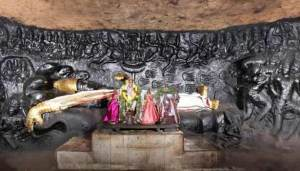

# 108 Divyadesam - 95) Tirumayam

**Details of Kshethram**:

**Moolavar:**  Satyagirinathan

**Thayaar:**  Uyyavanda Nachiyar

**Vimanam**: Satyagiri Vimanam

**Pushkarani:** Satya Pushkarani

<!-- wp:paragraph -->

**Travel:** This kshetram is located between Karaikkudi and Pudukkotai.

**Azhwar Pashuram:**

Tirumangaiazhwar: 9 Pashurams

**Sthala Puranam:**

The deity Satyagirinathan is in a reclining posture and is surrounded by Garuda, Markandeya and Brahma in a rock-cut temple. It is believed that Adisesha emitted poisonous fumes which appear to look like *jwala* ( balls of fire ) to frighten the demons Madhu and Kaitabha who tried to kidnap Lakshmi Devi after stealing the Vedas. The Lord is said to have saved Lakshmi Devi who is seen to be very scared hiding near the Lord's *tiruvadi* and recovered the Vedas from the demons.
