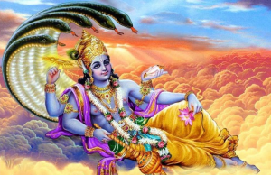
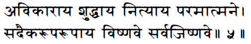

# Vishnu Puranam- 01- An Introduction to Creation

In Sanathana Dharma, there are two primary sources of information, namely ***ithihasams*** and ***puranams***. Ithihasams are further divided into two, namely Sri Mahabharatam and Srimad Ramayanam. Puranams again are many, but the eighteen main puranams are placed in three baskets as six each. The three divisions are ***Sattvic Puranams, Rajasic Puranams,*** and ***Tamasic Puranams***. In Sanathana Dharma, most scriptures are based on questions and answers. For example, if we take our ithihasams, Janmejaya asked questions to Maharishi Vaishampayana, and Sri Mahabharatam was the answer. Maharishi Valmiki posed the questions, and Devarishi Narada replied, and thus Srimad Ramayanam was obtained. Along similar lines, Maitreya asked Parashara Maharishi questions that gave us Sri Vishnu Puranam. Among the eighteen puranams, Sri Vishnu Puranam is held with the highest regard. The bhashyam for Sri Vishnu Puranam called Vishnuchittiyam was written by Yengalazhwaan ( Vishnu Chittar from Tiruvellarai ), who was a disciple of Swami Ramanujar. The story of Kurathazhwan and his memorization of the Bodhayana Vrithi Grantham is well known. When Swami Ramanujar was in the process of delivering his Sri Bhashyam, there was a conflict that arose with Kulothunga Chola. At this point, Swami Ramanujar moved to Karnataka to find safety and shelter from Kulothunga Chola. It was when in Karnataka that Swami Ramanujar discovered that Yengalazhwaan had the same dedication and abilities as Kurathazhwan in writing when dictated. So it was during this time that Yengalazhwaan wrote the Bhashyam for Sri Vishnu Puranam. Now we shall dive into the first part of Vishnu Puranam, which explains the creation of the world. Maitreya is said to have asked Parashara Maharishi, who was responsible for the creation, protection, and destruction of this world as we know it. To answer this question, Parashara Maharishi tells Maitreya that he, too, had asked this question many years ago and proceeded to narrate the story of Maharishi Vishwamitra and Maharishi Vasishta. Maharishi Vasishta and Vishwamitra were not always in good terms. Maharishi Vishwamitra was always on the hunt for the opportunity to outshine Maharishi Vasishta. In one such encounter, Maharishi Vishwamitra got into a scuffle with the sons of Maharishi Vasishta and created a brahmarakshas to kill them. One among Maharishi Vasishta's sons was Shakthi Maharishi, who was Parashara Maharishi's father. At the time when Shakthi Maharishi was murdered, his wife was expecting to deliver. After the child was born, it grew to be a great and knowledgeable person, just like his father and grandfather. The child soon learned that the cause for his father's death was a rakshasa. The child was extremely enraged and decided that he would rid the world of all rakshasas and began to perform a yagnam known as ***rakshasa-satram*** in which all the rakshasas would be drawn to the homa-kundam, and they would fall into the holy flames of the sacrificial altar losing their life. It was at this point that Pulastya Maharishi, who was the rakshasa guru at that point, decided to intervene as he would lose all of his students who might not have played any role in the killing of Shakthi Maharishi. Pulastya Maharishi rushed to the site where Parashara Maharishi was performing the yagnam and asked him to pause the proceedings to hear him out. Parashara Maharishi stopped to listen to what Pulastya Maharishi had to say. Pulastya Maharishi started by saying he was extremely shameful that and rakshasa was responsible for the death of Shakthi Maharishi. Still, the punishment being meted out to all the rakshasa kind by Parashara was unfair. Pulastya Maharishi told Parashara that whatever had happened was in the past, and the penalty being given to all present rakshasas was very harsh. Pulastya Maharishi thus requested Parashara Maharishi to stop the yagnam. Parashara Maharishi obliged to the request and terminated the yagnam. Impressed with the child's ability to listen to reason, Pulastya Maharishi blesses Parashara Maharishi, saying the child would experience ***Paramaathma-Jnanam*** resonating within his brain, thus enabling him to learn about everything in creation from Sriman Narayana Himself. Thus Parashara Maharishi became aware of the details of creation, preservation, and destruction of the world.

This Shloka from both Vishnu Saharanaamam and Vishnu Puranam tells us the Sriman Narayana is responsible for the creation, protection, and destruction of this world. Parashara Maharishi tells that all of creation can be divided into three tattvams, namely :

1. Chethana Tattvam: This refers to anything in creation that is capable of possessing knowledge, i.e., all jeevaathmas.
2. Achethana Tattvam: This refers to all the lifeless elements that are incapable of possessing any kind of knowledge.
3. Ishvara Tattvam: This refers to the Paramaathma, who governs both the Chethana and Achethana Tattvams. Thus, He is an embodiment of both Chethana and Achethana Tattvams.

In all of creation, the Chethana Tattam (the jeevaathma) is always dependent and related to the Paramaathma, who is eternal. Thus even the jeevaathma is treated as eternal. All the Chethana Tattvams require the help of the Achethana Tattvams to survive; therefore, Chethana, Achethana, and Ishvara tattvams are inseparable. With the relationship established between the three tattvams of creation, it becomes evident that Sriman Narayana is the One responsible for the creation, preservation, and destruction of this world.
