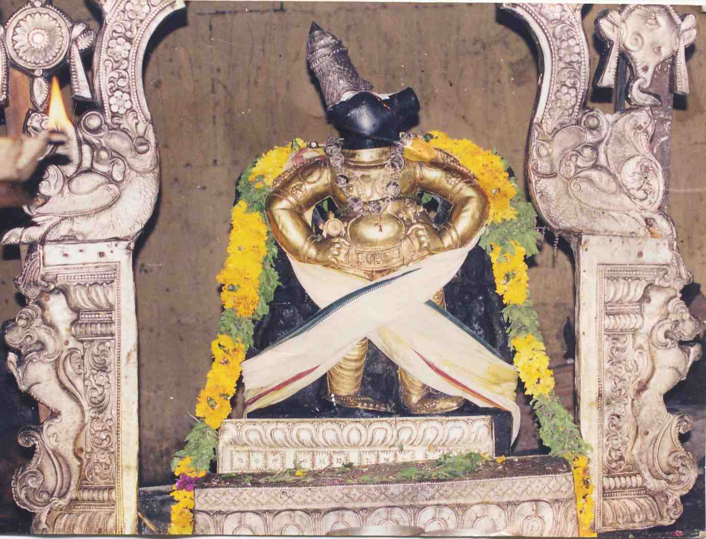

# Vishnu Puranam- 02 - Varaha Avataram

Today we shall see the story of Varaha Avataram as stated in Sri Vishnu Puranam and also know the kshethra maahatmiyam of Srimushnam. The most important highlight of the Varaha Avataram in Sri Vishnu Puranam is that there is no mention of Hiranyaksha. The story begins at a time just after pralayam had taken place. Lord Brahma was in the process of recreating the cosmos. In this venture, he did not pay enough attention to Bhoomi Devi. Lord Brahma had placed the earth in the waters of the pralaya-samudram before draining its waters. As a consequence, a layer of moss started to engulf the entire planet. All the Devas, headed by Indra, came to Lord Brahma to address the issue and find a way to help and save Bhoomi Devi. Lord Brahma looked at the magnitude of the problem and started to get worried. To calm himself down, Lord Brahma began to perform pranayamam. As Lord Brahma exhaled, a tiny wild boar came out of Lord Brahma's nostrils. From a small microscopic size, the wild boar grew to a gigantic scale. Lord Brahma was startled by the growth of the boar and immediately questioned the boar as to who he was. Devi Saraswathi, who was besides Lord Brahma, told Lord Brahma to look at the boar's eyes. The eyes of the boar were like two freshly bloomed lotuses. Lord Brahma immediately recognized that this boar was none other than Lord Sriman Narayana Himself. No sooner had Lord Brahma realized the Lord and paid his respects to him, did the Lord jump into the pralaya-samudram. Lord Varaha's tusks are described to be like two crescent-moon shaped sharp tusks. Lord Varaha lifted Bhoomi Devi from the pralaya-samudram and placed Her atop Adisesha to dry off and regain her pristine state. After she regained Her natural state, the Lord is said to have put Her in Her rightful place. A kshethram synonymous with Varaha Avataram is Srimushnam. We shall now see the kshethra maahatmiyam. **Details of Kshethram****Moolavar:** Bhuvaraha Perumal

**Thayaar:** Ambujavalli Thayaar **Vimanam:** Vamana Vimanam **Pushkarani:** Nitya Pushkarani **Travel:** This kshethram is located approximately about 40 km from Chidambaram. **Sthala Puranam:**  Once during the Pralaya process of a Krita Yuga, Hiranyaksha kidnapped Bhoomi Devi and took her captive deep with the waters of the deluge. Brahma became worried at this point. If Bhoomi Devi ceases to exist, then there would be nobody to bear the brunt of the Pralaya process, and creation would be at a setback. At this time, Brahma exhaled with a deep sigh, and from one of his nostrils emerged a tiny wild boar that grew into a gigantic size. The boar then bore long tusks, grew four arms, and held a mace, the Sudharshana Chakra, a conch, and a lotus in each of the four arms. The Lord hid His conch and chakra in his waist and went in pursuit of Bhoomi Devi. The Lord rescues Bhoomi Devi by carrying her with his tusks and places her back in the position where she was to rest. Soon Hiranyaksha receives news that a boar bearing a mace had rescued Bhoomi Devi. Hiranyaksha, in a fury, rushes to find and recapture Bhoomi Devi when he comes face to face with Lord. Lord Varaha and Hiranyaksha fight continuously for hundreds of years, and finally, the Lord slays Hiranyaksha. Hiranyaksha's final wish before he died was that the Lord face in his direction; thus, the Lord's face is facing the south. Due to a long drawn out battle with Hiranyaksha, the Lord was sweating profusely. The Lord took a moment to rest, and all His sweat drained into a low lying crater. This is now worshipped as the Nitya Pushkarani. The Lord is standing with His hands, on His hips where the devotee can see the Panchajanya Shankam and Sudarshana Chakram. Sridevi and Bhoomi Devi can be seen on either side of the Lord standing facing the west direction. This kshethram is one of the eight swayam-vyaktha kshethrams. The Lord is said to be a swayambhu murthy made of shalagrama-shila. This is one of the few kshethrams wherein Nitya-Abhishekam is performed for the Lord. It is said that couples without children are blessed by the Lord here once they take a bath in the Nitya Pushkarani.
