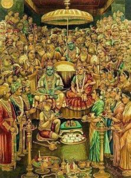

# Vishnu Puranam - 07 - Sri Rama Charithram

The story of Lord Rama in Sri Vishnu Puranam is very brief. Parashara Maharishi has only touched upon the most significant events that took place in the life of the Lord as Sri Rama. The first event discussed by Parashara Maharishi is the birth of the Lord through the ***putrakamayeshti yagam***. There is no discussion of Sri Rama's education under Maharishi Vasishta. The next story discussed is that of Rama and Lakshmana going to the forest with Maharishi Vishwamitra to destroy the demonic forces of Taataka and her two sons Maricha and Subahu. After killing Taataka and Maricha, the two princes, along with Maharishi Vishwamitra, go to Mithila, where Lord Rama frees Ahalya from her curse. The next event discussed is Lord Rama's marriage to Devi Sita and calming down Lord Parashurama. Parashara Maharishi then moves forward to the point where Rama, Lakshmana, and Sita are sent to the forest. Parashara Maharishi then moves the scene to Panchavati, where Shoorpanaka meets Lord Rama and loses her nose at the hands of Lakshmana. Shoorpanaka goes crying to her brothers Khara and Dhushana, who challenge Lord Rama and Lakshmana to battle to avenge their sister's abuse. Khara and Dhushana are defeated. Shoorpanaka then goes to Sri Lanka and tells her brother Ravana everything that had happened at Panchavati. Ravana, with the help of Maricha, kidnaps Sita and takes her to Sri Lanka. Rama and Lakshmana meet Sugriva and, with his help, build a bridge to Sri Lanka from the southern shore of India. Once Rama and Lakshmana reached Sri Lanka with Lord Rama's army of monkeys, there were fierce battles that took place to reclaim Devi Sita. Ravana sent fierce warriors like Khumbakarna and Meghanadh, who were defeated on the battlefield. Soon Ravana himself came to the battlefield and attained moksham at the hands of Sri Rama. Lord Rama along with Lakshmana, Devi Sita, Hanuman, Sugriva, Angada, Nal, Neel, Jambavaan, and Vibhishana go back to Ayodhya in Ravana's ***pushpaka-vimanam*** where Lord Rama is coronated the King of Ayodhya.
