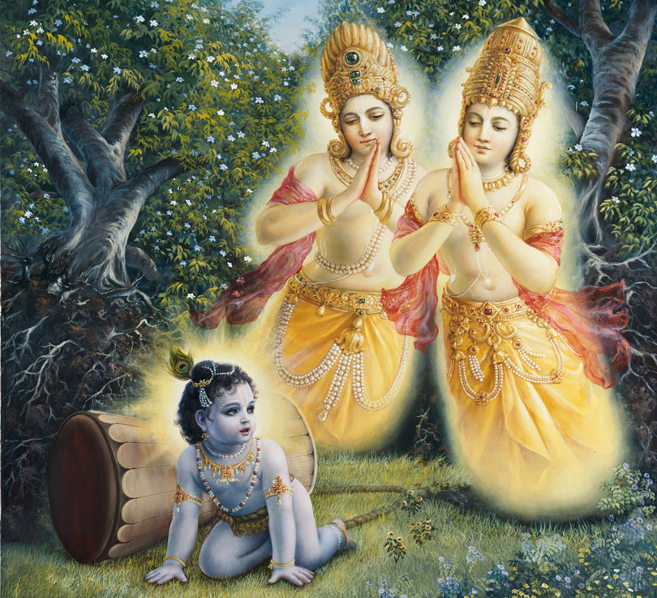
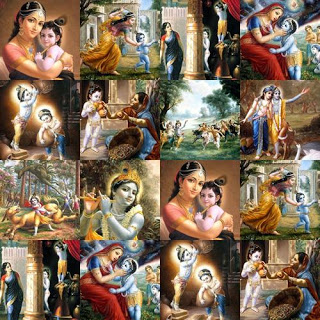
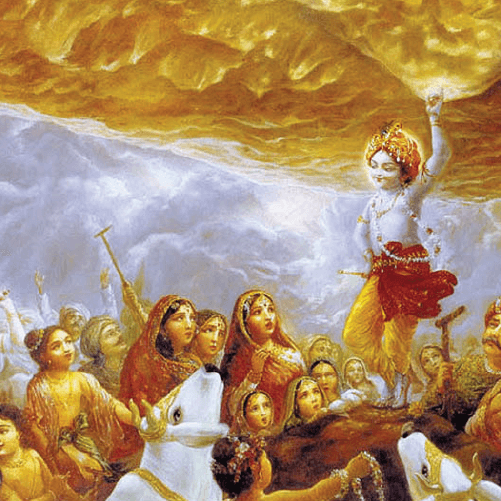
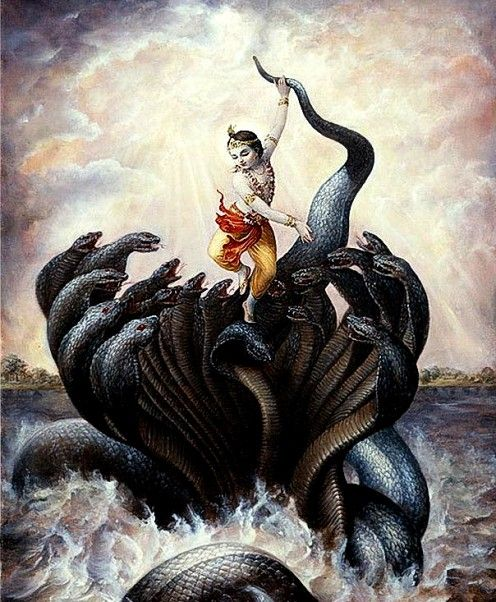

# Vishnu Puranam - 09 - Sri Krishna Leela

Upon birth, Lord Krishna instructed that he be taken to Gokul and, in his place, be brought back the daughter born to Yashoda and Nanda. As soon as he had given his instructions, all the chains binding Vasudev unlocked themselves. The doors of the prison also opened themselves. Vasudev put the baby in a basket, placed the basket on his head, and began his journey to Gokul. As he departed from the prison, Adisesha appeared to act as an umbrella to prevent the Lord from getting drenched in the rain. Vasudev began his journey, and no sooner than he began was faced with the obstacle of crossing the fast-flowing river Yamuna. As he started to cross the river, the water level continuously started to rise. The water rose until it had touched Lord Krishna's feet. As soon as the water had touched Lord Krishna's feet, the water immediately started to go down. The river further made way for Vasudev to cross without causing any further hindrance. Vasudev crossed the Yamuna and made his way to Nanda's house, where, as per the Lord's instruction, Vasudeva exchanged his baby with the baby girl of Nanda. The exchange was made, and Vasudev returned to his prison cell in Mathura. As soon as he entered his cell, all the doors automatically closed, and the clamps of his chains also returned to how they were before he left. Shortly after this, the baby girl started to cry. The crying of the baby woke the guards who had fallen asleep. The guards immediately informed Kansa, who bolted into the prison, demanding that the baby is surrendered. Vasudev and Devaki tried to show him a reason that the voice from the sky had said their eighth son would be the one to kill him. Having no mercy, Kansa grabbed the child violently and attempted to fling the child against a stone. But as he raised the child to throw her, the child flew out of his hand and took on the form of Yogamaya (Durga). Kansa was baffled by the events taking place before his eyes. Yogamaya then spoke saying, " There's no meaning in trying to stop fate. The one destined to be your end still lives". Saying this, Yogamaya vanished. A few days passed by. Kansa was taken aback. He had to find a way to stop the prophecy from coming through. He summoned Poothana. Poothana could change her appearance and also could withstand any poison that entered her body. Kansa ordered her to go to every neighboring village and kill any newborn or a few months old babies by breastfeeding them with poisoned milk. As instructed, Poothana went on a killing spree, killing almost all the infants in and around Mathura. Finally, she reached Gokul and heard that Nanda and Yashodha had a baby who was a few days old. She looked for an opportunity when Nanda was out of the house, and Yashodha was busy and took the child out of the house in an attempt to kill him. She changed her form back to being a demon and started to feed the Lord. Soon she realized that something was wrong, and the child was not drinking the milk but was sucking the life out of her. She desperately tried to escape the baby, but before she knew it, she was no more. The demon fell to the ground with a colossal thud. Hearing the sound, people from all over the village gathered to see a sizeable hideous body that lies dead on the ground with Lord Krishna playing innocently with mud near the demon. Soon news of Poothana's death reached Kansa. He was baffled when he heard the news that Poothana was killed, and all the people could talk about was how a little child was found playing in the vicinity. He then summoned Shakatasura, who could transform himself into a cart and trample anyone who lay beneath him. Kansa instructed Shakatasura to go to Gokul, find the one responsible for the death of Poothana, and kill that person. Shakatasura went to Gokul and found out that the whole village was in a very festive state. When he asked around, he found out that it was the first birthday of Krishna and that everyone in the village was going to Nanda's house to bless the baby. Shakatasura saw the festivities as a way to slip into the village and find out about Poothana's death. When he found out that the baby found near Poothana's body was none other than Krishna then he became determined to kill the baby. As the rituals of the birthday went on, the Lord pretended to fall asleep. As soon as Shakatasura saw that the baby was sleeping, he knew that he had an opportunity to kill Krishna. He immediately assumed the form of a cart. As it was a very sunny day, the cart cast the optimum shade for the baby to be kept under while he was asleep. The rituals continued, and suddenly a roaring sound was heard from near where Krishna had been kept to sleep. Shakatasura had tried to trample Krishna, but the Lord stopped with one leg and kicked with his other leg turning the cart into hundreds of tiny pieces. News then came back to Kansa, saying even Shakatasura was no more. Kansa grew anxious and summoned Trinavrata. Trinavrata could manipulate the wind at his will. Kansa instructed Trinavrata to go to Gokul and find out who killed his comrades and kill the person responsible. Trinavrata made his way to Gokul, where he saw Yashodha was carrying Krishna in her arms and a pot of water on her head. He made the wind to blow at very high speeds. Lord Krishna immediately identified his enemy and magically increased his weight. Yashodha soon lost her stamina and let Krishna walk on the ground. As soon as she put Krishna down Trinavrata scooped Krishna into the sky and tried to drop him from a height to kill him. But as soon as he threw the Lord, he came back flying and soared to an even greater height, seeing this Trinavrata rose to the height at which he saw Lord Krishna last but couldn't find him. Lord Krishna latched on to Trinavrata from behind and strangled him to death. Soon the news of Trinavrata's death also reached Kansa. He tried multiple times by sending numerous other demons but to no avail. After the incident with Trinavrata, a few months passed by. Lord Krishna has almost turned four years old. One day Krishna and his brother Balarama were playing when Balarama noticed that Krishna was eating mud. Balarama immediately ran to Yashodha and told her what was happening. Yashodha, upon reaching the playing area, questioned Krishna if he was eating dirt to which he replied that he wasn't. Yashodha saw the dirt on Krishna's hands and asked him to open his mouth. As Krishna opened his mouth, Yashodha saw the entire universe in front of her eyes. She could see the Sun, the Moon, and all the planets. Further, she could see Indra-Lok then Kailash then Brahma-Lok and finally Vaikuntham (the heavenly abode of Lord Vishnu). Failing to comprehend anything that she saw in front of her eyes, she forgot why she had even come to the play area and returned home—like this Lord Shri Krishna performed many miracles in the lives of the people of Gokul. Lord Krishna was very fond of stealing butter from the houses of the gopis who lived in Gokul. One beautiful day the women had enough and decided to tell Yashodha that the stealing had to stop. Once they said Yashodha, she became furious, and as soon Krishna came home, she tied him up to a stone used to make butter from milk and went to finish some work in the house. Krishna dragged the stone into a nearby forest where he saw two intertwined trees with a small gap in between. Krishna slipped through the gap but couldn't get the stone to pass along with him. As he pulled the stone, the two trees got uprooted. From the uprooted trees emerged two Gandharvas, who were cursed by a sage to become trees. Lord Vishnu had promised them that he would relieve them of this curse when he took the form of Krishna, and in uprooting the trees had fulfilled his promise.

A few years passed by. The people of Gokul had become weary of the multiple demon attacks that the village was facing and hence decided that they would move out of the village to another nearby village Vrindavan to live peacefully. In Vrindavan, Krishna becomes famous in no time at all for his charming looks and for his skills of playing the flute.

Lord Krishna won the hearts of all the people of Vrindavan in a short period. He performed many miracles during his brief stay in Vrindavan. Kansa continued his attempt to find Krishna in Vrindavan by sending multiple demons to find and kill Krishna. The most prominent of the demons being Agasura, Bakasura, and Dhenukasura. Once when Krishna and all his friends were out grazing their cattle, they encountered a cave opening that they hadn't ever encountered before. Krishna's friends entered one after the other but didn't come out. Soon seeing the pattern, Krishna realized that this wasn't an ordinary cave opening but Agasura. Agasura could transform himself into a giant snake, and as anything entered, his mouth would fall asleep inside, and he would close his mouth immediately, digesting anything that had entered. Krishna entered his mouth, and as soon as he entered, Agasura closed his mouth. Krishna made sure that he safely moved his friends and all the cattle to safety, after which he started to grow in size. He grew to an extent wherein Agasura couldn't contain Krishna as he ripped through Agasura's stomach freeing his friends and cattle. On another occasion, Krishna and his friends were playing, and Krishna was blindfolded when a huge bird swooped from above and took Krishna in his massive jaws and flew away. Krishna is said to have split his beak in two killing him in the process. One day Krishna and Balarama were sitting at home when they heard that there was a grove of palm trees nearby, which was left untouched because of a demon who used to live near the grove. This demon was none other than Dhenukasura, who could transform himself into a rampageous donkey who kicks had the power to kill. Krishna and Balarama told their friends not to worry and took them to the grove. Soon Dhenukasura realized that someone had entered his forest and were eating the fruit. He transformed into his donkey form and went on a rampage. Balarama grabbed him by the tail and hurled against the face of a nearby hill killing him.

Once Krishna saw that the villagers were offering prayers to Indra so that they could get good rains for the sake of reaping good produce. Krishna stopped them and advised them to worship the Govardhan Hill as it gave lush pastures for their cows to graze, and it also gave many different varieties of fruits. The villagers saw Krishna's point and ignored their prayers to Indra and started to worship Govardhan. Indra was enraged by this and flooded Vrindavan with incessant rains which spanned for seven days and nights. When he came to see the outcome of his wrath, he saw that all the people were unharmed and were standing under the shelter of Govardhan, which was being lifted by Krishna on his little finger of his right hand. Indra, upon seeing this, realized that nobody who was under the shelter of the Lord could be hurt in any way. He instantly stopped the rains and apologized to the Lord, saying his power had blinded him, but he has now realized his responsibility.

Once Lord Krishna was playing ball near the river Yamuna when the ball fell inside. The area was said to be the home Kaliya the Naga, who was dwelling in the waters of Vrindavan, where he would be safe from his sworn enemy Garuda. Kaliya had begun to spew his venom into the waters of the Yamuna, which was claiming the life of cattle and humans alike. Using the fallen ball as an excuse, Krishna jumped into the waters of the Yamuna and brought Kaliya to the surface. As soon as Kaliya reached the surface, Lord Krishna jumped onto Kaliya's hood and danced on his hood till he started to bleed and slowly started to die. They were seeing their husband's fate Kaliya's wives pleaded to Krishna that he spare their husband. Krishna agreed to spare Kaliya's life if he were to abandon the waters of the Yamuna and return to Ramanaka Dwip (Modern day Fiji). Thus, he saved the people of Vrindavan from an impending threat.
