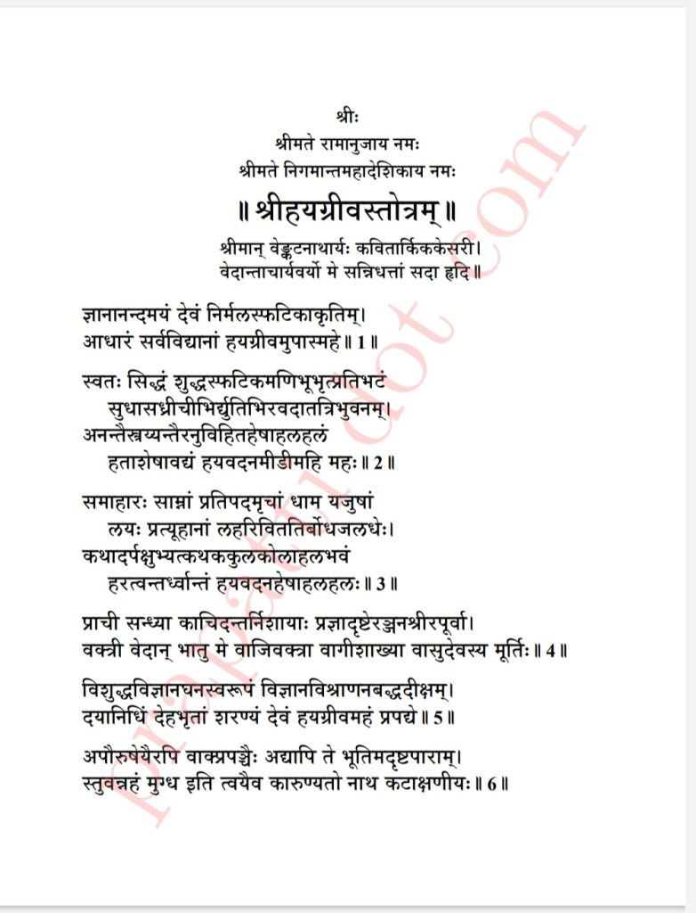
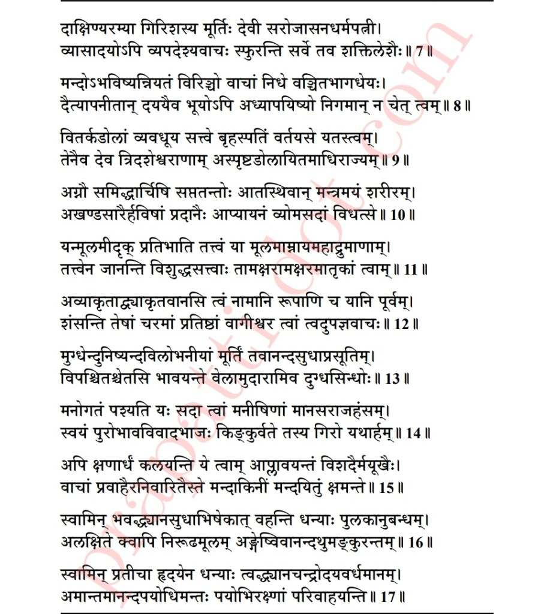
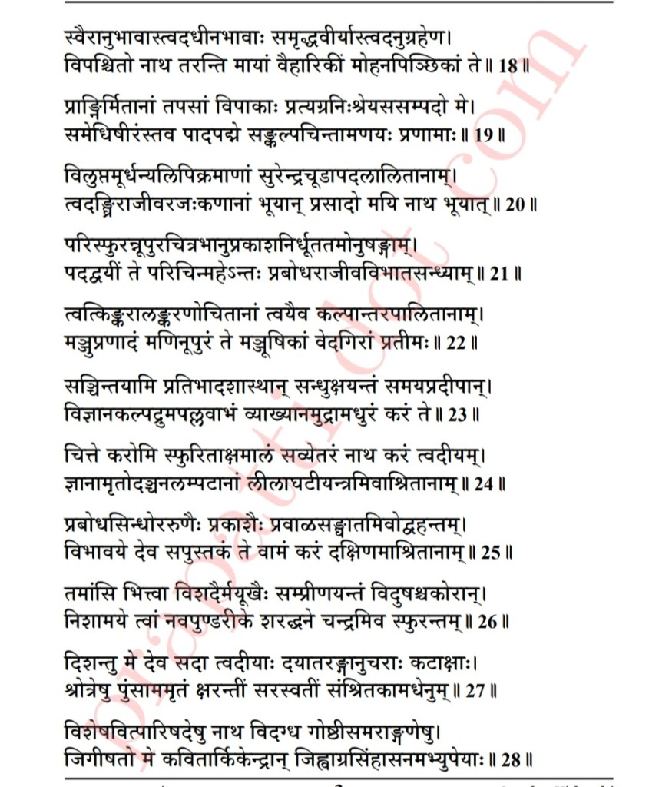
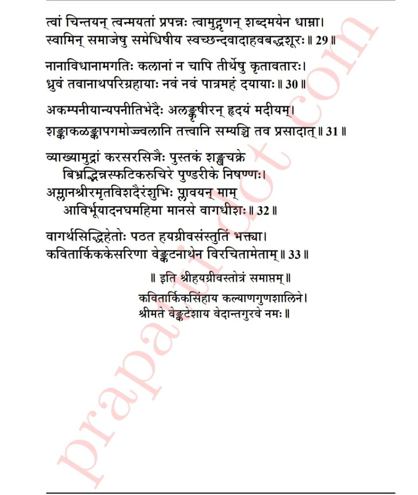

# Desika Vaibhavam - 03 - Hayagriva Stotram

By age twenty, Swami Desikan had become a mastered scholar of everything in Vaishnavism that had existed till then. At age twenty-one, he got married to a woman named Kanakavalli. To add to his existing repertoire of knowledge, his uncle Kidambi Appullar taught him the Garuda Mantram. To meditate upon the Garuda Mantram, Swami Desikan chose to go to Oushadagiri at Tiruvahindrapuram as there was a river known as Garuda that flows there. This was also a hillock that fell from the Sanjeevini mountain that Hanuman had brought to heal Lakshmana during Ramayana. Upon reaching Tiruvahindrapuram, Swami Desikan bathed in the Garuda nadhi prayed to Lord Devanatha and Vaikunthanayaki Thaayar. After praying to the Lord, he found a large Ashwath Tree under which he started to perform japam of the Garuda Mantram. Soon Lord Garuda appeared in front of Swami Desikan and said he was impressed with the level of devotion and concentration shown by Swami Desikan and bestowed upon him the Hayagriva Mantram. Lord Garuda instructed Swami Desikan to meditate upon this mantra with utmost concentration and devotion. Swami Desikan meditated upon the given mantra with complete devotion. Impressed with his concentration and devotion, Lord Hayagriva appeared before Swami Desikan and blessed him with the nectar of knowledge. After blessing Swami Desikan, the Lord asked Swami Desikan to ask him for a boon. Swami Desikan asked the Lord to be forever seated at the tip of his tongue so that the words that would come out of his mouth would be rich with knowledge, be authoritative and correct. Lord Hayagriva then presented Vedanta Desikan with an idol of Himself, which has been passed down and is currently being worshiped at the Parakala Muttam situated in Mysore. In praise of the Lord, Swami Desikan composed the Hayagriva Stotram. One who chants this stotram will attain true knowledge of education will attain good concentration in studies, fluency in speech, mastery in debates, vocabulary, and excellent memory power.

