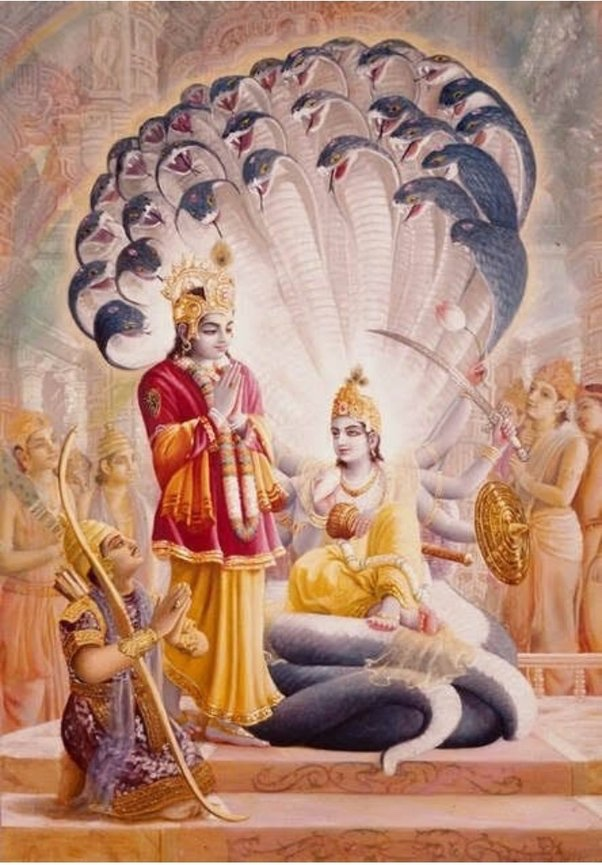

# Nara-Narayana: The Profound Bond Between Krishna and Arjuna

**Krishna ensures Draupadi marries Arjuna:****Krishna makes sure Subhadra marries Arjuna:** **Krishna becomes Arjuna's charioteer:**  **Krishna Preaches the Bhagavad Gita to Arjuna:** **Krishna protects Arjuna from Jayadratha's boons:**  **Krishna shields Arjuna from Karna's arrows and makes Karna's sarpa-astra miss Arjuna:** **Krishna protects Arjuna from the blazing of the chariot after the war:**

