# Tirumala Navaratri Brahmotsavam

**Venkatādri samaṁ sthānaṁ brahmāṇḍe nāsti kiñcana।****Venkateśa samo devo na bhūto na bhaviṣyati॥** The Tirupati Brahmotsavam is a majestic nine-day festival celebrated at the Tirumala Venkateswara Temple. This sacred event draws millions of devotees to partake in divine rituals and vibrant processions dedicated to Lord Venkateswara, the preserver of the universe. Brahmotsavam, held in the Tamil month of *Purtassi* (October), coincides with Navaratri, and according to tradition, it is said that Lord Brahma himself descends to earth to preside over this festival, inviting celestial beings to witness and participate in the divine celebrations. In 2024, the Brahmotsavam will be celebrated from 3rd October to 12th October. Each day during this period is filled with sacred ceremonies, known as Utsavams, that depict various divine aspects of Lord Venkateswara. Below is the complete schedule for the festival, followed by detailed descriptions of each day’s Utsavam so that readers can appreciate both the timing and significance of every ritual.  **Main Brahmotsavam Activities** Before diving into the day-by-day breakdown, it is essential to understand some of the recurring themes and activities that form the heart of Brahmotsavam: - Aalaya Suddhi: The temple is cleaned and decorated before the festival begins to create a purified and sacred environment. Alankaram, the adornment of the temple, is completed with flowers and mango leaves. - Mritsangrahanam: The ritual of collecting earth, known as Mritsangrahanam, is performed the day before the festival starts. This earth is used for the Ankurarpanam ceremony, a symbol of fertility and abundance. - Dwajarohanam: On the first day, the Garuda Dhwaja (flag with the emblem of Garuda) is hoisted, signaling the start of the festival. This flag invites the celestial gods to participate in the celebrations. - Vahana Seva: Each day, Lord Venkateswara is taken in a grand procession on various Vahanas (vehicles). Each Vahana carries symbolic meaning, and together, they portray different aspects of the Lord’s role in the cosmos. - Snapanam and Choornabhishekam: These are daily bathing rituals of the deity, meant to refresh the Lord after the processions and signify purification. - Chakrasnanam: On the final day, the Sudarshana Chakra and the Lord are bathed in the sacred temple tank, Swami Pushkarini, with devotees also partaking in this holy ritual. **Brahmotsavam Schedule for October 2024:** 3 October 2024 - Thursday - Ankurarpana Night: 7 pm to 8 pm - Ankurarpana (Sowing of seeds) The festival begins with the Ankurarpana ceremony, a sacred ritual where nine types of grains are ceremonially sown. This act symbolizes the beginning of a prosperous festival and the abundance of blessings that will follow. Along with Vishvaksena Aradhana (worship of Vishvaksena, the commander of the Lord’s armies), this ceremony marks the purification of the earth and the start of Brahmotsavam.

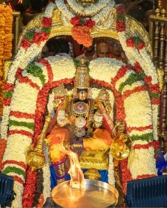

4 October 2024 - Friday - Day 1 - Dwajarohanam Afternoon: 3.30 pm to 5.30 pm - Bangaru Tiruchi Utsavam (Golden Tiruchi Procession) This early-afternoon procession features Lord Venkateswara being carried on a Golden Tiruchi, a ceremonial platform, through the streets of Tirumala. It sets the tone for the grandeur of the coming days.

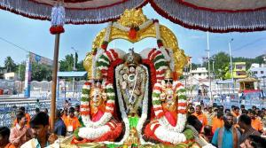

Evening: 5.45 pm to 6 pm - Dwajarohana (Flag Hoisting) The official commencement of Brahmotsavam happens during Dwajarohanam, where the Garuda flag is hoisted at the Dwajasthambham. This flag invites the gods to join the festivities, signaling the beginning of the divine celebrations.

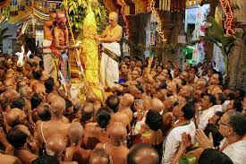

Night: 9 pm to 11 pm - Pedda Sesha Vahanam (Large Adisesha Vehicle Procession) On the first night, the Lord is carried on the Pedda Sesha Vahanam, representing Adisesha, the divine serpent on which Lord Vishnu rests in Vaikuntam. Adisesha symbolizes service, and this procession reflects Lord Venkateswara’s willingness to serve his devotees. The Tirumala Hills themselves are believed to be the manifestation of Adisesha.

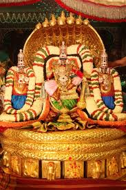

5 October 2024 - Saturday - Day 2 Morning: 8 am to 10 am - Chinna Sesha Vahanam (Small Adisesha Vehicle Procession) Continuing the theme from the previous night, the Lord is carried on the Chinna Sesha Vahanam, a smaller serpent vehicle. This procession emphasizes the Lord’s protective and nurturing qualities, as Adisesha is the embodiment of divine protection.

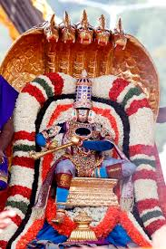

Afternoon: 1 pm to 3 pm - Snapana Thirumanjanam (Holy Bath) After the morning procession, Snapana Thirumanjanam is performed, where the Lord is bathed in herbal water, relieving the Lord of any strain caused by the earlier processions. This sacred bath symbolizes purification and refreshment.

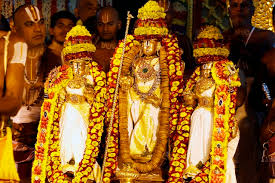

Night: 7 pm to 9 pm - Hamsa Vahanam (Swan Vehicle Procession) In the evening, the Lord is carried on the Hamsa Vahanam (swan vehicle), representing purity, wisdom, and discernment. According to Hindu tradition, the swan has the ability to separate milk from water, symbolizing the Lord’s ability to distinguish between good and evil.

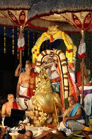

6 October 2024 - Sunday - Day 3 Morning: 8 am to 10 am - Simha Vahanam (Lion Vehicle Procession) On the third morning, Lord Venkateswara rides the Simha Vahanam, symbolizing strength, power, and royalty. The lion is also associated with Narasimha, an avatar of Lord Vishnu, who signifies protection and the destruction of evil.

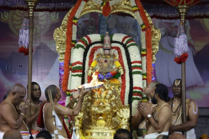

Afternoon: 1 pm to 3 pm - Snapana Thirumanjanam (Holy Bath) As with each day, the Lord undergoes the Snapana Thirumanjanam after the morning procession, signifying purification after the Lord's journey through the streets of Tirumala.

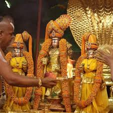

Night: 7 pm to 9 pm - Muthyala Pallaki Vahanam (Pearl Canopy Procession) The Muthyala Pallaki Vahanam is a procession where the Lord is carried under a pearl-adorned canopy. Pearls symbolize purity, royalty, and divine grace, making this a particularly beautiful and spiritually significant event.

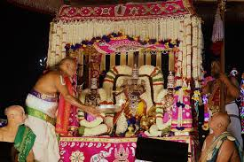

7 October 2024 - Monday - Day 4 Morning: 8 am to 10 am - Kalpa Vruksha Vahanam (Wish-Fulfilling Tree Procession) In the morning, Lord Venkateswara is carried on the Kalpa Vruksha Vahanam, representing the Kalpavriksha, a mythical wish-fulfilling tree. This Vahana emphasizes the Lord’s ability to grant boons and fulfill the desires of his devotees.

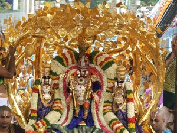

Afternoon: 1 pm to 3 pm - Snapana Thirumanjanam (Holy Bath) This sacred bath purifies and refreshes the Lord after the procession.

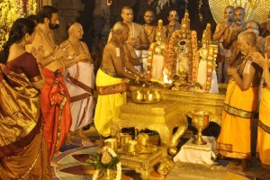

Evening: 7 pm to 9 pm - Sarva Bhoopala Vahanam (All Kings Procession) The Sarva Bhoopala Vahanam symbolizes that all the kings of the earth submit to the divine rule of Lord Venkateswara. This procession highlights the Lord’s authority over all earthly rulers and his role as the protector of dharma.

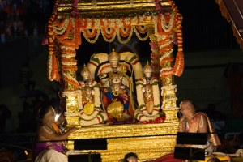

8 October 2024 - Tuesday - Day 5 Morning: 8 am to 10 am - Mohini Avatharam (The Mohini Incarnation) The Mohini Avatharam celebrates the divine story where Lord Vishnu took the form of Mohini, an enchanting woman, to distribute the Amrutham (elixir of immortality) to the Devas during the churning of the ocean. This incarnation is honored with a procession where the Lord is dressed as Mohini and carried in a pallaki (palanquin), symbolizing the Lord’s divine intervention in restoring cosmic balance.

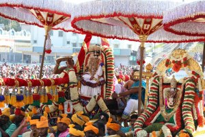

Night: 6.30 pm to 11.30 pm - Garuda Vahanam (Garuda Vehicle Procession) One of the most important and highly anticipated events of Brahmotsavam is the Garuda Vahanam procession. Garuda, the mighty eagle, is not only the vehicle of Lord Vishnu but also symbolizes the Vedas—the ancient scriptures that are the foundation of Hindu wisdom and knowledge. Garuda, as the embodiment of the Vedas, represents divine knowledge and spiritual power, while Lord Venkateswara personifies what the Vedas describe and preach. He is the ultimate embodiment of truth, dharma, and the cosmic order. The Garuda Vahanam procession thus becomes a deeply significant event, where the Lord of the Vedas is carried on the very vehicle that represents the sacred texts themselves. This divine alignment is a reminder that Lord Vishnu, in all his avatars, is the essence of what the Vedas reveal—the protector of righteousness and the sustainer of the universe. Due to this profound connection, the Garuda Vahanam is considered the most important of all the processions during Brahmotsavam, drawing massive crowds of devotees who gather to witness and receive blessings from this auspicious event.

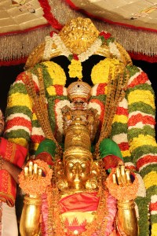

9 October 2024 - Wednesday - Day 6 Morning: 8 am to 10 am - Hanumantha Vahanam (Hanuman Vehicle Procession) In the morning, Lord Venkateswara rides the Hanumantha Vahanam, representing Hanuman, the epitome of devotion and service. Hanuman’s dedication to Lord Rama (an incarnation of Lord Vishnu) is a reminder of the importance of loyalty and selfless service.

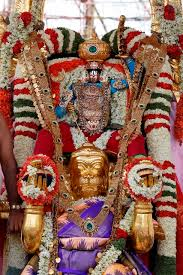

Evening: 4 pm to 5 pm - Swarna Rathotsavam (Golden Chariot Procession) The Swarna Rathotsavam is a dazzling event where the Lord is taken in a procession on a golden chariot, symbolizing prosperity, wealth, and divine majesty. This chariot is intricately decorated and attracts large crowds of devotees.

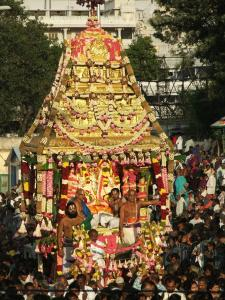

Night: 7 pm to 9 pm - Gaja Vahanam (Elephant Vehicle Procession) The Gaja Vahanam represents the elephant, a symbol of royalty and wealth in Hindu tradition. Elephants are associated with Lord Vishnu’s ability to remove obstacles and bring good fortune.

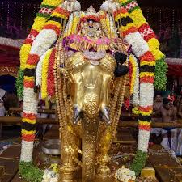

10 October 2024 - Thursday - Day 7 Morning: 8 am to 10 am - Surya Prabha Vahanam (Sun Chariot Procession) On the seventh day, the Lord rides the Surya Prabha Vahanam (sun chariot), symbolizing the Sun’s life-giving energy and the Lord’s power over the cosmos. This procession honors the Lord’s central role in the universe.

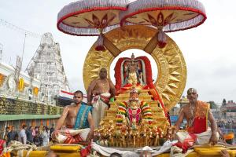

Night: 7 pm to 9 pm - Chandra Praba Vahanam (Moon Chariot Procession) In contrast to the morning’s Sun chariot, the Chandra Praba Vahanam (moon chariot) represents the soothing and calming energy of the moon. It symbolizes peace, serenity, and the Lord’s ability to provide comfort to his devotees.

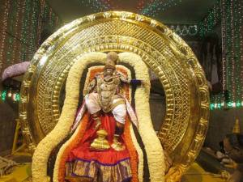

11 October 2024 - Friday - Day 8 Morning: 7 am onwards - Rathotsavam (Grand Chariot Procession) The Rathotsavam is one of the most significant processions of Brahmotsavam, where Lord Venkateswara is carried in a grand chariot pulled by devotees through the streets of Tirumala. Witnessing this procession is believed to bring liberation from the cycle of rebirth.

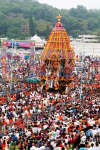

Evening: 7 pm to 9 pm - Ashwa Vahanam (Horse Vehicle Procession) In the evening, the Lord rides the Ashwa Vahanam (horse vehicle), symbolizing speed, energy, and the readiness to protect dharma. Horses also play an important role in Hindu mythology as part of the divine forces.

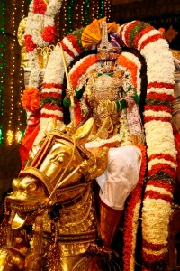

12 October 2024 - Saturday - Day 9 Early Morning: 3 am to 6 am - Pallaki Utsavam & Tiruchi Utsavam The final day begins with the Pallaki Utsavam and Tiruchi Utsavam, where the Lord is taken in a procession during the early hours of the morning. This procession serves as a final blessing before the day’s concluding rituals.

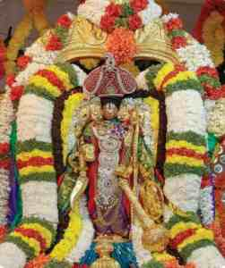

Morning: 6 am to 9 am - Chakra Snanam (Holy Bath of Sudarshana Chakra) The Chakra Snanam is a sacred bath for Lord Venkateswara and the Sudarshana Chakra in the holy waters of Swami Pushkarini. Devotees are also allowed to bathe in the tank, which is believed to purify and grant divine blessings.

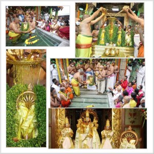

Evening: 8.30 pm to 10.30 pm - Dwajavarohanam (Lowering of the Flag) The festival concludes with the Dwajavarohanam, where the Garuda flag hoisted on the first day is ceremonially lowered, signaling the end of Brahmotsavam. The celestial gods return to their realms, and devotees depart with the blessings of Lord Venkateswara.

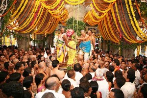

Brahmotsavam is not just a festival but a divine journey that connects devotees with the celestial world. Each day brings a unique experience of devotion, ritual, and celebration, offering participants a chance to witness the majestic grace of Lord Venkateswara. From the grand processions of the Vahanas to the final holy bath of the Sudarshana Chakra, the festival allows devotees to immerse themselves in spiritual joy and divine blessings.
