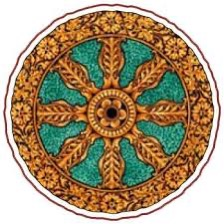

# The Cosmic Cycle of Creation: Maha Vishnu, Garbhodakshaayi Vishnu, and Ksheerodakshaayi Vishnu

To understand the vastness of the cosmos described in Vedic traditions, one must be willing to set aside ordinary notions of time and space. What we call a universe, immense beyond measure, is revealed as but one of countless such creations. And what we call history, stretching back thousands of years, is but a fleeting moment in a grand, cyclical drama that has been unfolding eternally.

In this vision, life and matter do not simply appear at random. Everything exists within a purposeful arrangement, overseen by a higher intelligence. Central to this profound order are three forms of Lord Vishnu, often referred to as the Purusha Avatars: **Maha Vishnu**, **Garbhodakshaayi Vishnu**, and **Ksheerodakshaayi Vishnu**. Each plays a distinctive role:

• **Maha Vishnu** governs the creation and dissolution of countless universes at once.

• **Garbhodakshaayi Vishnu** enters each universe to shape its internal structure and guide the emergence of stars, planets, and living beings.

• **Ksheerodakshaayi Vishnu** dwells within every universe to preserve balance, uphold moral order, and intervene as necessary by appearing in various divine incarnations.

By understanding these three aspects, we gain insight into a cosmos that is neither accidental nor lifeless. Instead, it is a grand tapestry woven from cycles of creation and renewal, moral struggles and triumphs, and the journeys of countless souls seeking meaning, growth, and ultimate liberation.

**Maha Vishnu: The Infinite Source of Universes**

-

Consider the boundary between what might be called spiritual reality and the material realm. In that unimaginable expanse lies the Causal Ocean, a limitless reservoir beyond ordinary perception. It is here that Maha Vishnu resides, poised at the very origin of time, matter, and space as we know them.

From this oceanic vantage point, creation unfolds not just once, but ceaselessly. With each exhalation of Maha Vishnu, innumerable universes, known as Brahmāṇḍas, emerge. Each universe is like a bubble floating on the surface of a boundless sea, each containing the seeds of galaxies, stars, and all the phenomena we associate with cosmic existence. When Maha Vishnu inhales, these universes vanish back into Him, returning to a state of latency until the cycle begins anew.

This process occurs over astonishing timescales known as kalpas—periods so vast that even the lifespan of a galaxy is but a brief episode. The essence here is that creation is not a linear event but an eternal rhythm, a cosmic breathing. Such an idea stretches our ordinary sense of time, challenging us to imagine a reality in which entire galaxies appear and disappear like sparks in a cosmic fire.

In this framework, what we consider enormous and ancient—the billions of years of cosmic history that scientists speak of—is still modest. Endless cycles of birth and dissolution have come before, and will come again. Maha Vishnu’s role is to preside over this cosmic heartbeat, ensuring that universes are never lacking in potential, never closed off from the possibility of life and knowledge.

**Garbhodakshaayi Vishnu: The Cosmic Architect Within Each Universe**

-

When a particular universe springs forth from Maha Vishnu’s cosmic breath, it exists initially as a vast, unstructured arena. Though filled with potential, it awaits the shaping hand that will draw forth order from chaos. This is where **Garbhodakshaayi Vishnu** enters. He lies upon the Garbhodaka Ocean, which fills half of the universal egg, representing an intermediate state between pure potential and manifested form.

From the navel of Garbhodakshaayi Vishnu emerges a lotus, and upon this lotus sits Lord Brahma, the appointed secondary creator. Brahma is endowed with the knowledge and capacity to transform raw matter into structured systems—to forge stars that will shine for billions of years, to gather dust into planets, and to nurture conditions that allow life to arise in countless forms. In this manner, the universe is not just a static place but an evolving classroom, rich with opportunities for growth and exploration.

**The Fourteen Planetary Systems: A Ladder of Existence**

Within each universe, existence is not uniform. According to this cosmic vision, the universe is divided into fourteen primary planetary systems (lokas), arranged conceptually as a vertical hierarchy. These realms range from spiritual and enlightened domains near the top to more materially engrossed and challenging worlds below. The Earthly realm rests roughly in the middle, offering a balance of material struggle and spiritual potential.

**The Seven Higher Realms (Uttara Lokas):**

1. **भू: (Bhūloka)**: Our own Earth and its immediate surroundings. Here, life is a blend of joy and sorrow, of moral choice and existential questioning. It is a realm of opportunities for ethical growth, scientific inquiry, and spiritual practice. Earth’s challenges inspire beings to seek meaning and transcend their limitations, making it a pivotal realm for spiritual progress.

2. **भुव: (Bhuvarloka)**: Extending above Earth is Bhuvarloka, inhabited by subtle beings—semi-divine entities and spirits who influence thoughts and energies more directly than on Earth. The density of material suffering is less here, but so is the urgency that can drive deeper spiritual inquiry. This realm acts as a bridge between the earthly and heavenly worlds.

3. **सुवः (Svarloka)**: Often identified as a heaven-like region, Svarloka is home to devas—beings of light and virtue who enjoy refined pleasures, long lifespans, and a more harmonious environment. Yet even this realm is not permanent; souls who reside here do so based on their accumulated merits. When these merits diminish, they may return to lower realms. Thus, Svarloka is delightful but not the final goal.

4. **महः (Maharloka)**: Populated by great sages and enlightened souls, Maharloka is a realm of profound contemplation. Freed from many earthly distractions, beings here engage in deep study and meditation. They live in closer resonance with divine truths, experiencing a clearer understanding of cosmic principles.

5. **जनः (Janarloka)**: Higher than Maharloka, Janarloka is inhabited by even more spiritually advanced entities who have transcended most material desires. The atmosphere is saturated with wisdom and serenity. Beings here are closer to liberation, having shed much of the ignorance that binds souls to repetitive cycles of birth and death.

6. **तपः (Tapoloka)**: A realm of intense spiritual austerity, Tapoloka is where beings focus wholeheartedly on meditation, self-discipline, and purity. Here, the distractions of lower realms vanish almost entirely. The residents engage in sustained introspection, drawing ever nearer to the threshold of full liberation.

7. **सत्यं (Satyaloka)**: Also known as Brahmaloka, Satyaloka is the highest material plane. Here resides Lord Brahma, along with beings of extraordinary wisdom and purity. The experience in Satyaloka is so elevated that it nearly approaches the spiritual dimension. Liberation is within easy reach; souls here rarely return to lower states unless they choose to assist in cosmic tasks.

**The Seven Lower Realms (Adho Lokas):**

1. **अतल (Atala)**: Below the Earthly plane lies a series of subterranean worlds. Atala is the first of these, known for illusions and temptations. Pleasures here are intense but fleeting, drawing souls into webs of material attachment that hinder spiritual growth.

2. **वितल (Vitala)**: Vitala offers wealth, power, and material indulgence beyond what we can imagine on Earth. Yet this abundance is a double-edged sword. Without a grounding in dharma, beings here often lose themselves in hedonism and dominance, drifting farther from the search for truth.

3. **सुतल (Sutala)**: Remarkably, Sutala is governed by Bali Mahārāja, a virtuous and devoted soul who was blessed by Vishnu. Protected by divine grace, Sutala stands out as a harmonious realm despite lying in the lower planes. Though material, it is infused with an unusual sense of order and respect—a reminder that goodness can persist even in places remote from spiritual peaks.

4. **तलातल (Talātala)**: The domain of the architect Maya, Talātala is a realm of illusions, mystical technologies, and shifting appearances. Intellectual brilliance may thrive here, but it often serves self-interest rather than enlightenment. Without moral anchoring, the innovations and powers in Talātala keep souls ensnared in material games.

5. **रसातल (Rasātala)**: Deeper still, Rasātala is characterized by conflict, fear, and cunning. Souls here dwell amidst beings who prioritize their own gain at the expense of others. Such conditions reinforce ignorance and selfishness, making spiritual insight a distant prospect.

6. **महातल (Mahātala)**: Mahātala is inhabited by many-hooded serpents (nāgas) and beings who exist in a state of constant anxiety and suspicion. Life here is shadowed by lower instincts, from which escape is difficult. Compassion and understanding are rare currencies in such an environment.

7. **पाताल (Pātāला)**: At the bottom lies Pātāla, dazzling with hidden jewels and radiant lights. Yet these wonders are superficial, meant to captivate the senses without offering lasting fulfillment. The souls who dwell here are often absorbed in sensual pursuits, diverted from any urge to transcend material existence.

From highest to lowest, these fourteen realms form a cosmic ladder. Souls move along this ladder driven by their actions (karma), desires, and evolving understanding. Over multiple lifetimes, they may ascend toward realms of purer consciousness or descend into worlds of confusion and entrapment. The universe, as arranged by Garbhodakshaayi Vishnu and Brahma, thus serves as a complex field of moral, intellectual, and spiritual growth.

**Ksheerodakshaayi Vishnu: The Preserver of Balance and Moral Order**

-

Even with the universe structured and worlds in place, the cosmic story does not simply run like a mechanical clock. The fabric of existence is dynamic, influenced by the free choices of countless beings. Over long stretches of time, known as yugas or ages, moral and spiritual conditions can rise or fall. Societies may flourish in wisdom and compassion or descend into chaos and material obsession.

Enter **Ksheerodakshaayi Vishnu**, who resides within each universe, reclining upon the Ocean of Milk. This form of Vishnu acts as the preserver, sustaining the cosmic balance (dharma) and ensuring that souls are not abandoned to confusion. Dharma is the principle that upholds righteousness, harmony, and well-being. As eras pass and moral compasses become clouded, Ksheerodakshaayi Vishnu intervenes directly.

He appears as an avatar—an incarnation—taking forms suitable to the conditions of the time. Sometimes He comes as a prince who demonstrates the power of virtue and duty. At other times, He may appear as a cowherd who reveals the sweetest mysteries of devotion, or as a half-lion, half-man figure that protects the innocent and humbles the wicked. In each avataric appearance, Ksheerodakshaayi Vishnu restores dharma, guides sincere seekers, and rekindles the flame of hope and purpose.

These incarnations show that the universe is cared for. The divine is not distant or indifferent; rather, it responds to the cries of conscience and the pleas for guidance. In this eternal interplay, Ksheerodakshaayi Vishnu ensures that no matter how far souls stray, there remain pathways back to understanding, kindness, and truth.

**Cycles of Birth and Death: The Soul’s Long Journey**

The Vedic worldview does not limit existence to a single lifetime. Souls are seen as eternal sparks of consciousness, temporarily inhabiting various bodies and realms. Over countless births and deaths, individuals learn lessons, face challenges, and gradually refine their character. The 14 planetary systems serve as stages in this grand school of life, each offering unique tests and insights.

Yet, this cycle of birth and death can feel endless. Without recognizing the deeper meaning behind it, one might wonder if there’s an escape, a final release from the repetitive patterns of gain and loss, joy and sorrow. Indeed, the teachings emphasize that liberation (moksha) is possible—a state in which the soul transcends the material realms and no longer needs to return.

This reality is poignantly captured in a verse from **Bhajagovindam**, a meditation on life’s transient nature:

**“पुनरपि जननं पुनरपि मरणं**

**पुनरपि जननी जठरे शयनम्।**

**इह संसार बहुदुस्तारे**

**कृपयाऽपारे पाहि मुरारे।।”**

This stanza reminds us that birth leads again to death, which leads again to rebirth, and so on. Without spiritual awakening, souls remain caught in the cycle, returning again and again to the womb. The world is described as a difficult ocean to cross, and the verse calls upon Murari (a name of Vishnu) to rescue us through divine grace and insight.

**The Purpose Behind It All: Growth, Learning, and Liberation**

-

What might initially seem like a grand game of cosmic forces is, in fact, a purposeful system designed for the evolution of consciousness. Each realm, each incarnation, each moral dilemma is an opportunity for growth. The entire arrangement—Maha Vishnu setting the stage, Garbhodakshaayi Vishnu shaping the environment, and Ksheerodakshaayi Vishnu preserving ethical integrity—can be seen as a framework to help souls discover their true nature.

No soul is forced to remain in ignorance forever. Just as a student passes through various grades in school, ascending from simpler lessons to more advanced ones, souls climb or descend these cosmic realms based on their actions, desires, and choices. Over countless lifetimes, an individual can learn compassion, patience, humility, and devotion. Eventually, these virtues turn the mind inward, prompting the soul to seek something beyond the temporary successes and failures of worldly life.

When a being becomes fully aware of the eternal principles underlying existence, the cycle of birth and death ceases to feel like a trap. Instead, it reveals itself as a training ground that has prepared the soul for a greater reality—one that lies beyond all material forms and limitations.

**Relevance in Our World Today**

At first glance, these immense timescales, countless universes, and layers of existence may seem too abstract to have any bearing on our daily lives. Yet, the Vedic perspective encourages us to think differently. By contemplating the roles of Vishnu’s three forms, we realize that life is not an isolated accident. Our struggles and endeavors, our joys and sorrows, occur within a grand, meaningful framework.

This understanding can inspire humility. Recognizing that the universe is far larger and more complex than our immediate concerns puts things in perspective. Many of our worries, grudges, and material obsessions become less pressing when viewed against cosmic cycles spanning billions of years and countless worlds.

It can also inspire responsibility. If our actions influence our journey through these realms, then every choice matters. Kindness, honesty, generosity, and empathy are not just moral platitudes—they are forces that shape our path in the cosmic landscape. Acting with integrity aligns us with dharma, moving us closer to realms of light and wisdom. Acting harmfully entangles us further in webs of confusion and suffering.

**Conclusion: The Never-Ending Story of the Universe**

In this grand cosmology, the universe is far more than a random arrangement of particles. It is a living, evolving system guided by intelligence, compassion, and an unwavering dedication to moral growth. Maha Vishnu ensures that universes arise and subside in an eternal rhythm. Garbhodakshaayi Vishnu orchestrates the internal order of each universe, making it a fertile ground for life’s manifold expressions. Ksheerodakshaayi Vishnu preserves balance and ensures that souls always have a path back to truth, however far they may wander.

The fourteen planetary systems illustrate the breadth of possibilities, showing that life can unfold in worlds of great purity or stark materialism, spiritual splendor or moral confusion. Over countless cycles, souls traverse these domains, learning the lessons each provides. Eventually, they awaken to the eternal principles, reaching beyond all material forms and finding their true home in the spiritual reality that underlies all existence.

By contemplating these ideas, we shift our perspective. We become aware that our lives, our struggles, and our dreams are threads woven into a tapestry of unimaginable complexity and beauty. Understanding this cosmic vision encourages patience, perseverance, humility, and respect for the moral law that underpins the universe. It tells us that no effort toward goodness is wasted, no sincere quest for truth unanswered.

In the end, the Vedic cosmology presents the universe as a space of infinite opportunities. Every moment, every action, and every thought matters. We are never alone; the gentle, guiding presence of Vishnu’s three forms assures us that a divine intelligence cares for our progress. As we journey through life—through joys and sorrows, successes and failures—we do so in the shelter of a cosmos that nurtures us toward ultimate liberation and eternal peace.
