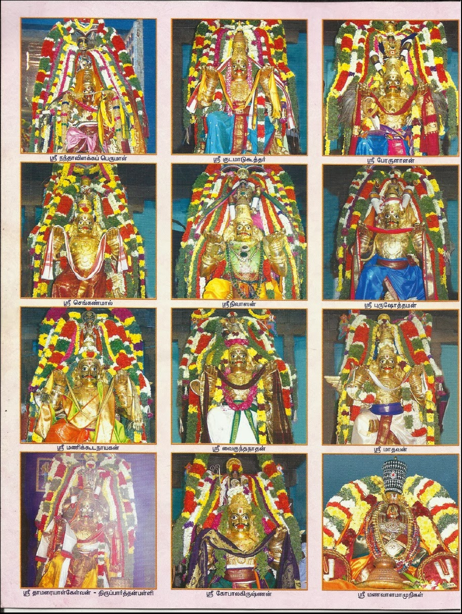
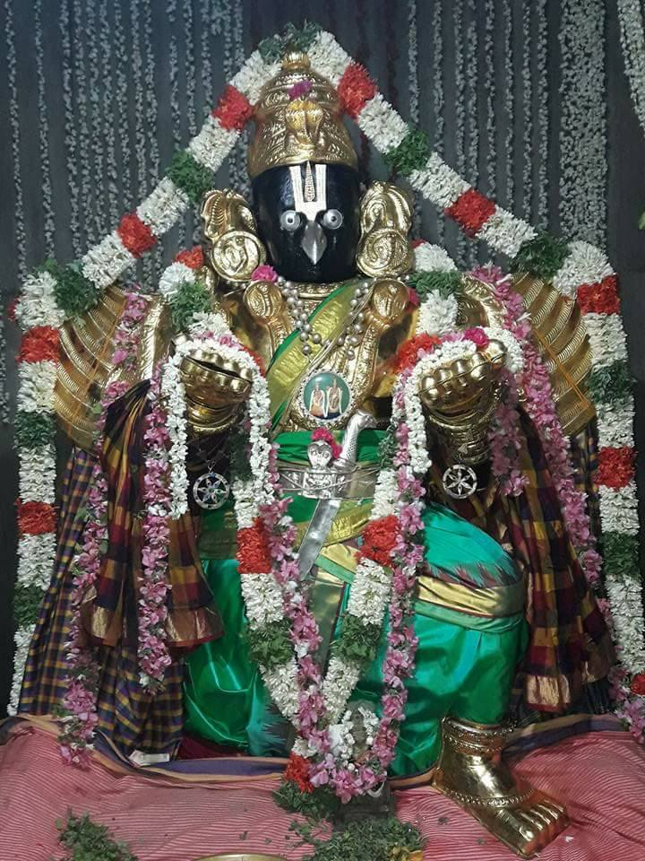

# Garuda Vaibhavam

Today is Thai Amavasya, which is marked as Garuda Jayanthi according to the Tamil Calendar. Let us see the story of Garuda, the divine vehicle of Lord Vishnu.

The tale of Garuda, found within the Adi Parva of the Mahabharata, is not merely the story of a celestial eagle’s immense power. It is a saga of bondage and liberation, rivalry and redemption, duty and devotion. It serves as a precursor to the great war of Kurukshetra, where the Pandavas and Kauravas, though of the same family, fight a battle that will shape the course of the world. Just as the Mahabharata unfolds as a war within a family, Garuda’s tale, too, revolves around conflict born of kinship, deception, and a relentless pursuit of dharma.

It begins with the great rishi Kashyapa, a sage whose penance and wisdom shaped many races of beings. Among his many wives, two stood out—Kadru and Vinata. Kadru, ambitious and calculating, wished for a thousand children, while Vinata, confident in her destiny, asked for only two but wanted them to surpass all of Kadru’s offspring. Kashyapa granted their wishes, and in due time, Kadru’s eggs hatched into a thousand Nagas, while Vinata’s eggs remained unhatched for a long time.

Impatience took root in Vinata’s heart. Unable to wait any longer, she broke open one of the eggs before its time. From it emerged Aruna, his upper body radiant like the sun, but his lower half incomplete. Though he was filled with divine brilliance, he was angered by his premature birth. He turned to his mother and rebuked her for her haste, declaring that because of her impatience, she would become a dasi. However, he assured her that when her second son was born, he would be her savior. With those words, Aruna left and, in time, became the eternal charioteer of Surya Deva, guiding the blazing chariot across the heavens.

Vinata, humbled by her mistake, waited patiently for the second egg to hatch in its own time. When it finally did, the world beheld a being unlike any other. His wings stretched vast as the sky, his feathers gleamed like molten gold, and his eyes burned with divine brilliance. This was Garuda, the king of birds, whose destiny was to challenge the might of the devas and soar beyond the reach of even Indra.

But even as Garuda grew into a celestial being of unparalleled strength, he discovered his mother was bound in servitude to Kadru and her serpent sons. Confused and angered, he demanded to know why. With sorrow, Vinata recounted the fateful bet that had sealed her fate.

One day, as Kadru and Vinata walked together, they saw the celestial horse Uchchaihshravas, a being of divine splendor who had emerged from the Samudra Manthana. Kadru, ever cunning, proposed a wager—she claimed that the horse’s tail was black, while Vinata, seeing its pure white form, disagreed. The bet was set: whoever was wrong would become the dasi of the other.

Kadru, unwilling to lose, devised a devious trick. That night, she called upon her serpent sons and ordered them to coil around the horse’s tail to make it appear black. But not all of her children were willing to comply. Some of the Nagas, recognizing their mother’s deceitful intent, challenged her plan. They argued that tricking their aunt into slavery was unjust, and that their race should not be tainted with dishonor.

Furious at her own children for questioning her, Kadru cursed them in her wrath. She decreed that those who defied her would perish in the great Sarpasatra Yagna, a fire sacrifice that would be conducted by a descendant of their own lineage. The Nagas who had opposed her were filled with dread, for they knew their mother’s curse would not be in vain. But those who remained loyal to her carried out her command. The next morning, when Vinata saw the horse again, she was shocked and devastated—the once-white tail now appeared black. She had lost the bet and, as per the agreement, was forced into servitude, her fate intertwined with that of her unborn child.

Garuda’s anger knew no bounds. He swore to free his mother from this unjust servitude. When he confronted Kadru and the Nagas, they set a near-impossible condition: he would have to bring them the Amrita, the divine nectar of immortality, which was jealously guarded by Indra and the devas in Svarga-loka. Only if he succeeded would his mother be set free.

Undeterred, Garuda set out on his perilous journey. But before he could reach Svarga, an overpowering hunger overtook him. Seeking guidance from his father Kashyapa, he was told of a great lake where he would find two mighty beings locked in an eternal struggle—a colossal elephant and a tortoise.

These creatures were not ordinary animals but were, in fact, two cursed brothers, Vibhavasu and Supratika, who had once been born into a noble lineage. However, greed and enmity had taken root in their hearts. Vibhavasu accused Supratika of coveting his wealth, while Supratika claimed that Vibhavasu had cheated him. Their bitter quarrel escalated until, in a fit of rage, they cursed each other into beastly forms. Vibhavasu became a tortoise, and Supratika an elephant, and even in their new forms, they continued their unending battle.

Garuda, sensing an opportunity to satisfy his hunger, seized both creatures in his mighty talons and flew off in search of a place to eat them. Alighting upon a great tree, he landed on a massive branch, only to hear the cracking of wood beneath his weight. To his astonishment, he saw that the branch was home to the Valakhilya rishis, tiny sages engaged in deep tapas. Realizing the danger of crushing them, Garuda caught the branch in his beak, ensuring their safety as he continued his flight. Finding a secluded place, he placed the rishis gently on the ground before devouring the elephant and the tortoise, satisfying his immense hunger.

Now fully empowered, Garuda soared towards Svarga, his mind set on the task ahead. As he approached, Indra and the devas stood ready for battle. But none could withstand his might—he shattered the deva defenses, outmaneuvered celestial weapons, and even overpowered Indra’s Vajra. With unmatched power, he stormed into the chamber of the Amrita and seized the divine nectar.

As he ascended, he encountered Vishnu himself. In that moment, Garuda was overwhelmed with devotion. Though he had just conquered Svarga, before Vishnu, he felt a sense of true surrender. The Supreme Lord, recognizing Garuda’s valor and righteousness, offered him a boon. Garuda asked only to forever serve at Vishnu’s feet, and in return, Vishnu made Garuda his eternal vahana, the one who would bear him across the three worlds.

Garuda, however, still had one last duty to fulfill. He returned to the Nagas and placed the Amrita before them. But just as they were about to consume it, Indra, on Vishnu’s guidance, seized the nectar, ensuring that the Nagas remained mortal. Their greed had led them to demand the Amrita, but fate denied them its blessings.

With his mission complete, Garuda had secured his mother’s freedom, and from that day forward, he became inseparable from Vishnu, a symbol of bhakti and dharma.

As time passed, the legend of Garuda and his unwavering devotion to Vishnu continued to be honored in various temples and sacred traditions. Among the most revered celebrations of Garuda’s glory is the Tirunangur Garuda Sevai, an extraordinary festival held in the Tirunangur region of Tamil Nadu. This grand event, deeply rooted in the tradition of Vaishnavism, brings together eleven different forms of Vishnu, each carried on the mighty shoulders of Garuda, symbolizing the supreme connection between the divine eagle and the Lord.

The Tirunangur Eleven Garuda Sevai takes place in the month of Thai (January-February) in the village of Tirunangur, near Sirkazhi. According to legend, this event traces its origins to a profound episode involving Lord Vishnu and the sage Uparicharavasu. It is said that after the great war of Kurukshetra, the sage, moved by Vishnu’s divine play, prayed for a vision of the Lord in multiple forms. To fulfill his devotion, Vishnu manifested as eleven distinct forms in the Tirunangur region, each enshrined in separate temples that would later be known as the Tirunangur Divya Desams.

The festival begins with the presiding deity of Tirunangur, Shri Vishnu, in the form of Thirumangai Azhwar, leading the procession. The Azhwar, a great saint and poet of the Tamil Vaishnavite tradition, is said to have sung in praise of these eleven Perumals. His deep devotion to Vishnu and Garuda is commemorated by this festival, where the utsava murthis (festival deities) of eleven different Perumal temples are brought together in a rare and majestic assembly.

Each deity is carried on Garuda Vahana, and the sight of eleven Garudas bearing eleven Vishnus is considered one of the most awe-inspiring spectacles in the Vaishnavite tradition. Devotees throng to witness this celestial convergence, for it is believed that seeing this event bestows immense punya (spiritual merit) and leads to the removal of sins. The deities that participate in the Garuda Sevai include:

1. Tirukavalampadi – Gopalakrishnan
2. Tiruarimeya Vinnagaram – Kudamaadukoothan
3. Tiruvanpurushottamam – Purushottaman
4. Tirusemponsei Kovil – Perarulaalan
5. Tirumanimada Kovil – Nandaivillaku Nara Narayanan
6. Tiruvaikuntha Vinnagaram – Vaikunthanathar
7. Tirudevanaar Togai – Devinayakan
8. Tiruttetriambalam – Pallikonda Ranganathar
9. Tirumanikoodam – Varadarajan
10. Tiruvellakkulam – Annan Perumaal
11. Tiruppaartanpalli – Parthasarathy Perumaal

    

    ***Tirunangur Padhanor Garuda Sevai***

As the procession moves forward, the sight of eleven Garudas carrying the deities creates an overwhelming sense of bhakti and divine ecstasy among the devotees. The rhythmic beats of the temple drums, the chanting of the sacred Vedas, and the powerful Divya Prabandham verses of the Azhwars echo through the air, transforming the village into a spiritual realm that mirrors Vaikuntha itself.

The Tirunangur Garuda Sevai is not just a visual spectacle; it carries deep spiritual significance. Garuda, the Vahana of Vishnu, represents the bridge between the human and the divine. His presence in such an event symbolizes moksha marga—the path to liberation. Just as Garuda carried Vishnu across the worlds, devotees believe that witnessing this event helps them transcend earthly attachments and move closer to attaining the grace of the Lord.

The festival culminates with the Thirumanjanam (holy bath) and mangalasasanam (divine hymn recitations) by the priests and devotees. After the deities have been honored, they return to their respective temples, leaving behind an atmosphere filled with divine energy and devotion.

The Tirunangur Eleven Garuda Sevai stands as a testament to the grandeur of Vishnu Bhakti and the unparalleled service of Garuda, who, despite his immense power, remains the most humble and devoted servitor of the Lord. This festival is a living embodiment of the connection between the Dhvaja (flag emblem) and the Vahana (vehicle), a union of devotion and divinity that continues to inspire countless devotees across generations.

Another fascinating procession involving Garuda is that of Kal Garudan at Nachiyar Kovil, a spectacle that continues to astound devotees with its divine mystery. Unlike any other vahana, this massive 10.5-foot idol of Garuda, carved entirely from Saligrama Shila, is enshrined in a separate sanctum outside the main temple. While Garuda is revered as the eternal carrier of Perumal in temples across Bharat, Kal Garudan of Nachiyar Kovil stands apart, not only for his grand stature but also for the unexplainable phenomenon that occurs during his procession.

According to legend, when the sculptor completed the idol’s wings, something astonishing happened—the stone Garuda began to ascend, as if preparing to take flight. Overcome by shock, the sculptor, in a desperate attempt to prevent it from soaring away, hurled a stone, striking Garuda’s nose. Immediately, the divine bird ceased its ascent and remained grounded. Ever since, Kal Garudan has stayed within the temple, continuing to bless devotees who come to seek his grace. Even today, a small mark on his nose serves as a silent testament to this event.

The Kal Garuda Seva, a grand annual procession held during Margazhi (December–January) and Panguni (March–April), brings forth a mystical occurrence that has been witnessed for generations. As the idol is brought out of his sanctum, the procession begins with only four devotees carrying the mighty Kal Garudan. He is adorned with a silk dhoti, dazzling ornaments, and a grand garland of flowers, befitting the vahana of Perumal.

However, as he moves through the prakaram (temple corridors), something extraordinary takes place—his weight begins to increase exponentially. With each successive layer of the temple’s prakaram, the number of bearers required to lift him doubles—from 4 to 8, then 16, then 32, and finally 64 people. By the time Kal Garudan reaches the Vahana Mandapam, an astounding 128 devotees are required to carry him.

A divine spectacle follows, as sweat forms on Kal Garudan’s body, visibly soaking his silk garments. Droplets of sweat appear on his nose, as if the idol itself were alive, experiencing the physical strain of carrying Perumal. Devotees believe this is not a mere illusion but a sacred manifestation of Garuda’s divine presence.

What is even more astonishing is the return journey. As Kal Garudan is carried back to the temple, his weight mysteriously decreases in reverse order. The 128 bearers gradually step away, until only four people are needed to place him back inside his shrine. This divine phenomenon remains one of the greatest wonders of the Vishnu temples, leaving devotees in awe and reaffirming Garuda’s unparalleled devotion to Perumal.

***Kal Garudan***

Garuda is not merely a vehicle of Vishnu; he is the very embodiment of the Vedas. The sacred scriptures of Sanatana Dharma are divided into two primary sections: Jnana Kaandam and Karma Kaandam. The Karma Kaandam deals with Yagna, the rituals and sacrifices that form the foundation of Vedic practices, emphasizing dharma, duty, and discipline. The Jnana Kaandam, on the other hand, delves into Vedanta, the essence of divine wisdom, focusing on Paramaathma and the realization of the Supreme Truth.

Garuda, in his eternal service to Vishnu, symbolizes the seamless transition from Karma to Jnana. The Garuda Sevai, an event where deities are borne upon Garuda’s mighty shoulders, represents Karma Kaandam leading devotees toward Jnana Kaandam. Just as Vedic rituals guide aspirants to deeper understanding and ultimately moksha, Garuda's flight is not just a movement through space but a spiritual journey—one that lifts the devotee from worldly actions toward divine realization.

In this way, Garuda is not just a Vahana but a Vedanta-Dhvaja, a banner of the Supreme Knowledge. His form itself is structured like the Vedas. The wings of Garuda represent Brahmana and Aranyaka, the guiding limbs of Vedic learning. His eyes are the Gayatri Mantra, illuminating the path of wisdom. His limbs represent the Shakhas of the Vedas, and his tail is Vyakarana, the very grammar that upholds the sacred texts. Most significantly, Garuda wears the Lord atop his shoulders, just as the Vedas carry Vedanta as their crown. The highest realization in the Vedas is the understanding of Paramaathma, and Garuda, by carrying Vishnu, signifies the ultimate purpose of knowledge—complete surrender to the Supreme Being.

Thus, Garuda Sevai is not merely a procession of deities but a profound philosophical representation of the soul’s journey from karma to jnana, from action to realization, from devotion to liberation. In the same way that Vedic knowledge culminates in Vedanta, Garuda’s service reaches its pinnacle in the divine act of bearing the Lord Himself. This eternal truth is what makes Garuda not only a Vahana but also the very breath of the Vedas, a timeless guide leading the way to Paramaathma’s divine embrace.

Jai Garuda Suparna!
