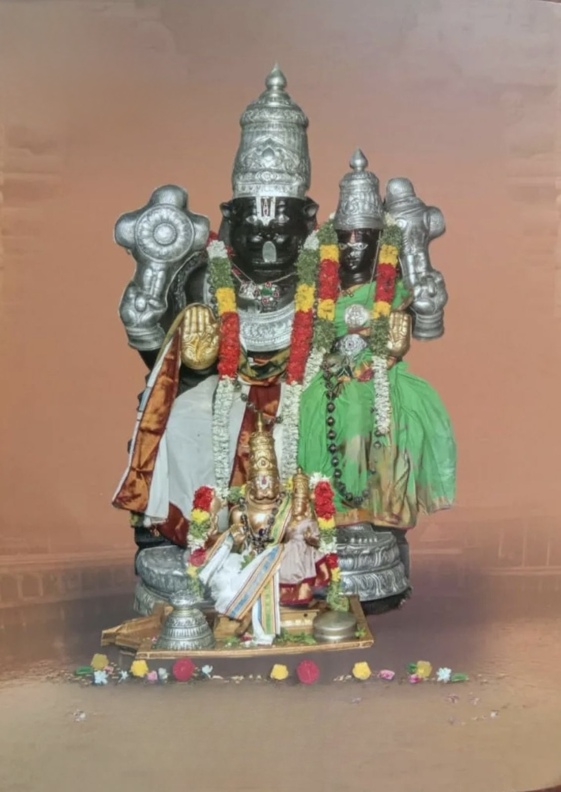
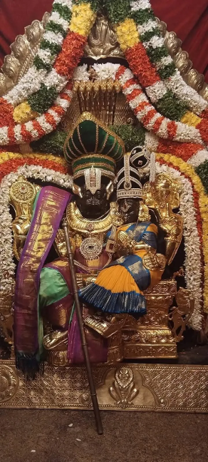
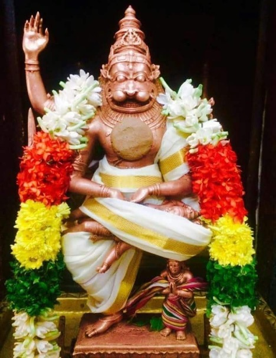

# Three Lesser-Known Narasimha Temples in Srirangam

When most people think of Srirangam, they immediately think of the grand Ranganathaswamy Temple. And rightly so—it’s massive, ancient, and packed with history. But tucked away in and around Srirangam are **three small but powerful temples** dedicated to Lord Narasimha. These are not the usual tourist spots, but if you’re someone who loves quiet places with strong spiritual energy, you’ll really enjoy visiting them.

Let me share a bit about each.

### **1. Kaattu Azhagiya Singar**

***Sri Kaattu Azhagiya Singar***

This one’s quite special. In fact, it’s believed to be older than even the main Ranganatha temple. “Kaattu” means forest, and in olden times, this place was exactly that—a thick forest between the Cauvery and Kollidam rivers.

Rishis used to live and do penance here. But wild animals, especially elephants, were a big problem. The rishis, though powerful, didn’t want to use their energy to fight them. Instead, they prayed to Lord Narasimha. And the Lord, moved by their devotion, appeared here and agreed to stay and protect them. Hence the name—**Kaattu Azhagiya Singar**—the beautiful lion-faced Lord of the forest.

The main deity is believed to be **Swayambhu (self-manifested)**. He’s seated, with **Lakshmi Devi on His left thigh**, and faces **west**, which is rare. The atmosphere is calm and powerful—you can feel the age and depth of the place.

There’s something interesting here: **there’s no Utsava Vigraham (festival idol)**. Since the temple was once deep in the forest and unsafe, the procession deity is kept in the **Koorathazhwan Sannidhi** inside the main Srirangam temple. And that practice continues even now.

But once a year, something beautiful happens—on **Vijayadashami evening**, **Namperumal (the utsavar of Srirangam)** comes in a grand procession to this temple. It’s believed that **Goddess Lakshmi performs penance here and hands Him a bow and arrow**, and Namperumal, on horseback, strikes an arrow at a Vanni tree—signifying the victory of good over evil. It’s a lovely sight to witness if you’re in town.

### **2. Aattru Azhagiya Singar**

***Sri Aattru Azhagiya Singar***

This one is easy to miss unless you know where to look. It’s near the **Cauvery bridge** that connects Chintamani and Thiruvanaikoil. Just before the bridge, take the right turn toward the bypass road—it’s on the left side a short distance in.

Here, **Lord Narasimha sits with Lakshmi Devi on His lap**, and she is shown in **Anjali Hastham**—folded hands facing Him in prayer. It’s such a touching depiction. This temple is especially popular among those praying for **a good marriage**.

There’s a nice backstory too. Originally, **Azhagiya Manavala Perumal** was the main deity here. But when Lakshmi Narasimhar came, He graciously gave His place to Him and moved to serve as the **utsavar**. There’s also a beautiful **Garuda Vahanam** with Narasimhar here. The whole temple has a warm, welcoming feel to it.

### **3. Mettu Azhagiya Singar**

***Sri Mettu Azhagiya Singar***

Now this one is actually inside the Srirangam temple complex itself—in the **5th prakaram**, near the **north gopuram**. It has a beautiful connection with the poet **Kambar**, who wrote the **Kamba Ramayanam**.

When Kambar came to present his Ramayanam in Srirangam, some Acharyas raised objections—mainly because it described the **Hiranya Samharam (killing of Hiranyakashipu)**. Kambar humbly said, “Let’s leave it to Perumal.” He prayed sincerely to Lord Narasimha—and suddenly, a **roar** came from this sannidhi, as if the Lord Himself was giving approval. After that, nobody said a word, and Kambar’s work was accepted.

Even today, that spot is called **Kambar Mandapam**, and right opposite, you’ll find the **Mettu Azhagiya Singar** deity. He’s in an intense posture—**with eight arms, Hiranyakashipu on His lap, and Prahlada below His knee**. It’s a powerful darshan, especially if you like deeper stories and history tied to the place.

### **Final Thoughts**

Each of these temples may be small compared to the Ranganatha temple, but they carry **a lot of soul**. Whether it’s the quiet protection of the forest Lord, the grace of marriage blessings, or the roar of truth that defended Kambar’s devotion—**Lord Narasimha reveals a different shade of Himself in each place**.

If you ever visit Srirangam, try adding these three temples to your list. You won’t find big crowds, but what you will find is **peace, power, and presence**.
