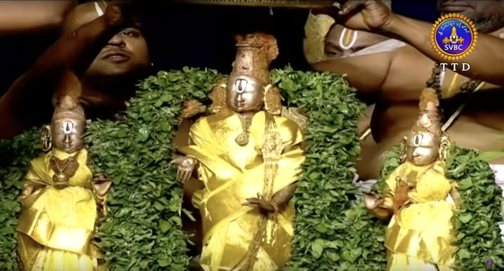
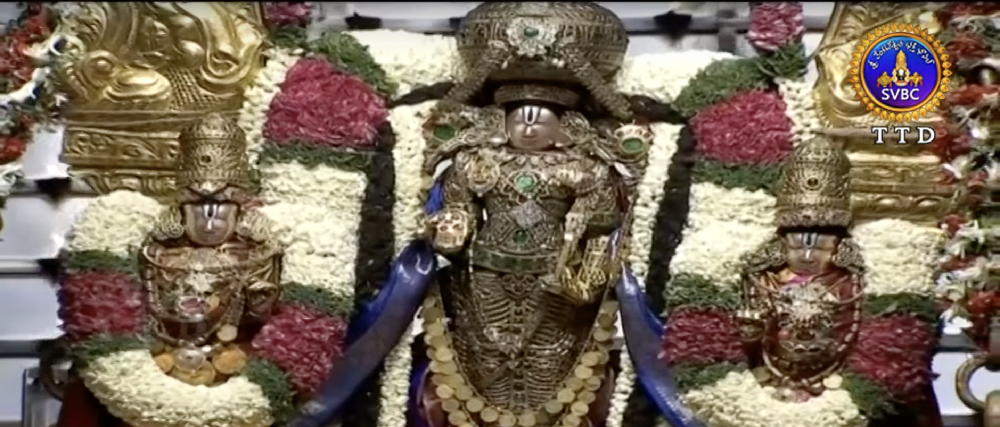
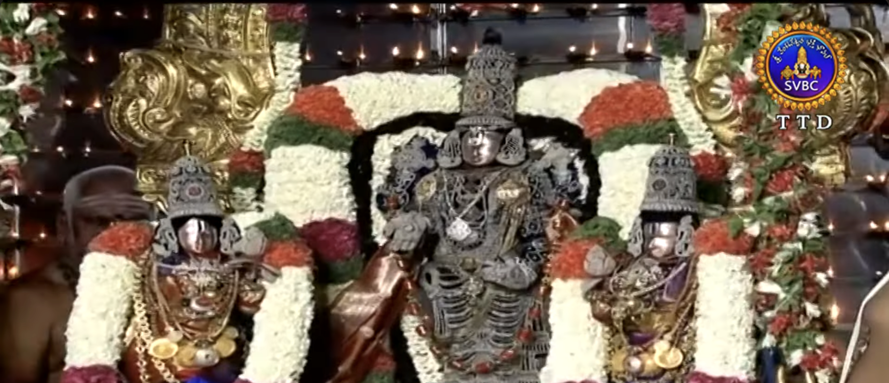
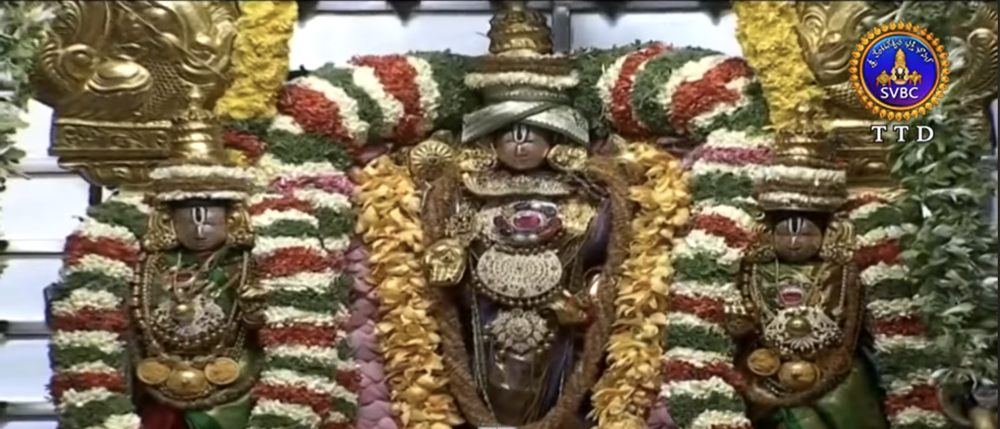

# Jyeshtabhishekam at Tirumala – A Timeless Ritual of Care and Sanctity

***Srivari Jyeshtabhishekam Credits to SVBC for the image***

Every year, as **Jyeshta Nakshatram** rises in the summer skies, the sacred hill temple of Tirumala observes one of its most meaningful and intimate festivals—**Jyeshtabhishekam**, also known as **Abhideyaka Abhishekam**. This year, it is being celebrated from **June 9 to 11**, inside the **Kalyana Mandapam** at the **Sampangi Prakaram**.

Unlike the grandeur of Brahmotsavam, Jyeshtabhishekam is more inward—focused on care, sanctity, and responsibility. Its primary purpose? To **preserve and protect the ancient utsava murtis** of **Sri Malayappa Swamy**, **Sridevi**, and **Bhudevi**—the very icons that bless millions of devotees through countless sevas and processions throughout the year.

## **Why is Jyeshtabhishekam Performed?**

The **utsava murtis**, believed to be over **800 years old**, were discovered in a dense valley called **Malayappa Kona** within the Seshachalam Hills. Over centuries, they have been lovingly worshipped, carried in processions, and bathed in sacred abhishekams. To protect them from natural wear and maintain their sanctity, the **Vaikhanasa Agama**, particularly the *Prakeerna Adhikara*, prescribes the **Abhideyaka Abhishekam**—a ritual to reinforce a **spiritual and physical shield** over the murtis.

## **The Three Sacred Days of Jyeshtabhishekam**

### **Day 1: Vajra Kavacham – The Diamond Armour**

***Vajra Kavacham Credits to SVBC for the image***

On the first day, the golden kavacham (armour) that the deities usually wear is reverently removed. The icons are then anointed with **Visesha Sugandha Tailam**, a special herbal oil with medicinal and protective properties.

This is followed by **Ashtottara Shata Kalasha Snapana Tirumanjanam**, where **108 silver kalashas**, filled with sacred dravyas like milk, honey, coconut water, turmeric, and sandalwood, are used in a grand abhishekam. The ritual is performed amid the recitation of **Pancha Suktas** and other Vedic chants.

In the evening, the Lord is adorned with the **Vajra Kavacham**—an exquisite armour entirely studded with **diamonds**. With His Consorts by His side, Sri Malayappa Swamy is taken out in procession around the **four Mada streets**, dazzling devotees with this rare and radiant form.

### **Day 2: Muthangi – The Pearl Armour**

***Muthangi Kavacham Credits to SVBC for the image***

On the second day, the deities are adorned with the **Muthangi**, a delicate and charming armour made of **pearls**. The elegance of this attire offers a softer, more serene vision of the Lord.

As on the first day, the evening includes a **procession along the mada streets**, allowing devotees to witness this graceful form, which is only seen once a year during Jyeshtabhishekam.

### **Day 3: Suvarna Kavacham – The Golden Armour Returns**

***Suvarna Kavacham Credits to SVBC for the image***

The final day is devoted to the sanctification and adornment of the **Suvarna Kavacham**, the **golden armour** traditionally worn by Sri Malayappa Swamy and His Consorts throughout the year.

Before it is placed, the armour is purified and re-consecrated in accordance with **Agamic procedures**. Once adorned, the deities resume their presence in this form, which continues through all major sevas and festivals until the next Jyeshtabhishekam.

While the Suvarna Kavacham remains on the deities year-round, **abhishekams like Snapana Tirumanjanam are still performed** during important utsavams, such as Brahmotsavam, Vasanthotsavam, and Pavitrotsavam, during which the deities undergo a full bathing. Outside of these occasions, the temple follows **careful procedures** to limit direct contact, ensuring the long-term preservation of the vigrahas without compromising the richness of the worship.

## **A Legacy Rooted in Time**

References to sacred festivals in **Thiruvengadam** (the ancient name for Tirumala) appear as early as the **Sangam period**, in Tamil classics like **Ahananuru** (1st century CE). This suggests that even 2,000 years ago, pilgrims were flocking to the hills to celebrate the Lord.

Through all dynasties, administrators, and modern transitions, the essence of this ritual has stayed intact, thanks to the tireless efforts of the **Vaikhanasa Archakas**, the **Ekangis**, and the **Jeeyar Swami**, whose guidance ensures that the Lord is worshipped exactly as prescribed in the Agamas.

## **In Closing**

Jyeshtabhishekam reminds us that divine love is not just expressed through offerings and praises, but also care, reverence, and responsibility. It’s a time when the Lord blesses us not only with beauty and darshan, but also with the lesson that even the Eternal Form deserves protection and mindful service.

May we all be blessed by Sri Malayappa Swamy in His many adorned forms—diamond, pearl, and gold—and may we continue to uphold the sacred traditions that keep His grace flowing through generations.

**Sri Malayappa Swamy Thiruvadigale Sharanam**
