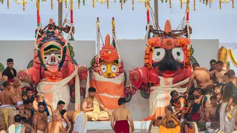
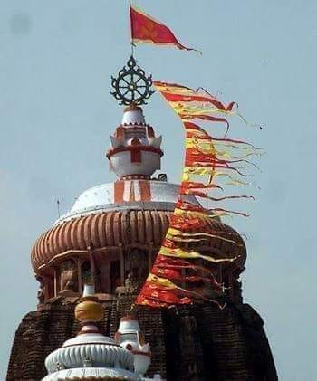

# Snana Yatra: The Sacred Bathing Festival of Lord Jagannatha

**Snana Yatra**, also known as *Deva Snana Purnima*, is one of the most spiritually vibrant and visually magnificent festivals in the Jagannatha tradition. Celebrated on the full moon day (*Purnima*) of the **Jyestha** month, this festival marks the ceremonial bathing (*abhisheka*) of Lord Jagannatha, accompanied by Lord Balabhadra and Devi Subhadra.

***Jagannath, Bhalabhadra, and Subadra at the Snana Mandapam***

### **A Divine Public Darshan**

On this auspicious day, the deities are brought out of the sanctum sanctorum of the 12th-century Shree Jagannatha Temple in Puri and placed on the *Snana Mandap*—a special platform built for this sacred event. This is a rare occasion when devotees from all walks of life, including those who are not permitted inside the temple, get to witness the Lord in full glory.

As the Vedic mantras reverberate and conches blow, **108 pots of sanctified water** drawn from the *Sunakua* (golden well) are poured over the deities. This grand ritual is not only a symbol of divine cleansing but also reflects the Lord’s boundless compassion—He allows Himself to be touched by the elements and seen by the masses.

### **Scriptural Significance**

The **Skanda Purana**, **Padma Purana**, and **Jagannatha Mahatmya** provide deep theological context to this event. According to these texts, Snana Yatra is a reenactment of bathing ceremonies offered to Lord Vishnu in various incarnations—be it Vamana, Varaha, or Rama.

Though Lord Jagannatha’s form appears wooden (*daru murti*), His presence is fully divine. His Snana is not just an outward ritual—it is an act of cosmic love, purification, and mercy.

### **The Royal Rituals**

The day begins with the **Pahandi ritual**, a grand procession where the deities are carried from the inner sanctum to the *Snana Mandap*. This year, the first deity brought out was Lord Sudarshana, followed by Lord Balabhadra, Devi Subhadra, and finally Lord Jagannatha.

In the afternoon, **Gajapati Maharaj Dibyasingha Deb**, the titular king of Puri and the foremost sevaka (servitor), performs the ceremonial sweeping of the bathing platform—a ritual known as **Chhera Pahanra**—symbolizing humility before the Lord.

The deities are then dressed in **Gaja Vesha**, a special adornment that depicts them as the elephant-headed God, Ganesha, signifying their all-encompassing divinity.

### **Anavasara: The Lord Falls Ill**

Following the elaborate bathing, the deities retire to a secluded chamber known as the **Anavasara Ghar** (isolation room), where they remain out of public view for **14 days**. This period is referred to as **Anavasara-lila**, wherein the Lord seemingly falls ill due to the cold caused by the water bath.

- The temple *Baidya* (traditional physician) administers herbal medicines.
- Devotees experience the mood of **vipralambha bhakti**—the sweet pain of separation from the Lord.
- This lila symbolizes that even in divine separation, love deepens and longing intensifies.

### **Anticipation of Ratha Yatra**

Devotees eagerly await the **Netrotsava** or “Eye Festival,” which takes place just before the world-famous **Ratha Yatra** (Chariot Festival). On this day, the public receives their first glimpse of the rejuvenated deities in their fresh youthful forms (*Nabajouban Darshan*), just before they mount their majestic chariots for the grand procession.

### **Why Snana Yatra Matters**

Snana Yatra is more than a ritual—it is an **embodiment of divine accessibility**. Lord Jagannatha, whose very name means "Lord of the Universe," steps out of the inner sanctum for **everyone**, reaffirming the core of **bhakti**—that God is not confined to boundaries, hierarchies, or caste.

In witnessing the Lord bathed, decorated, and lovingly cared for, we are reminded that **divinity is both majestic and intimate**, grand yet accessible, transcendent yet immanent.

***Patita Pavana Chakram atop the temple***
