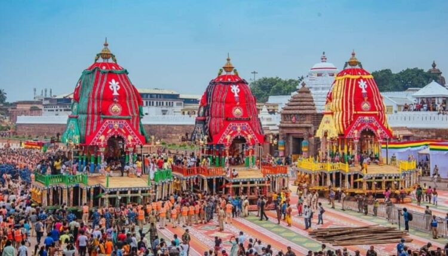
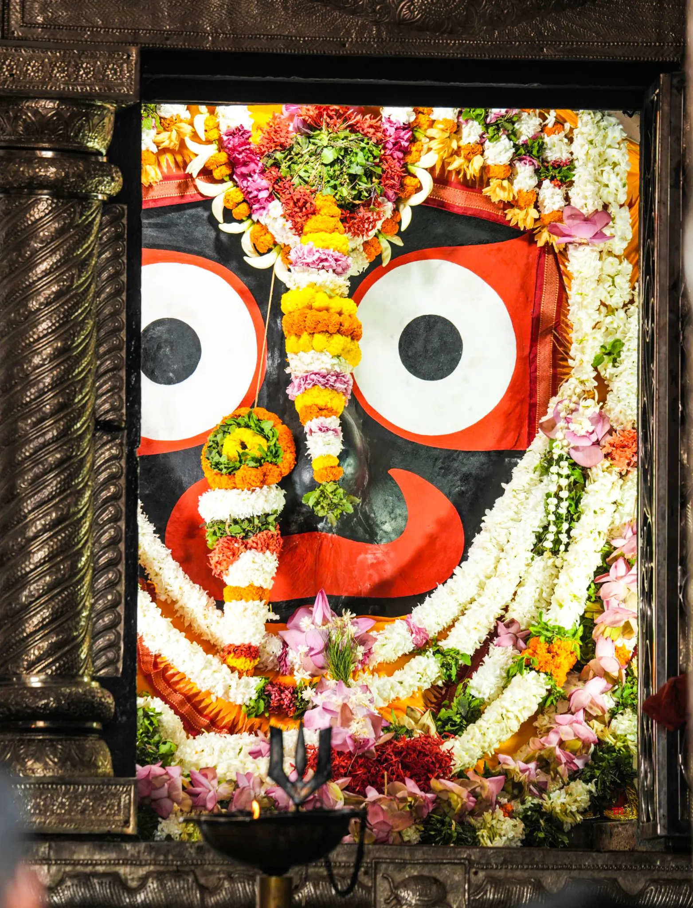
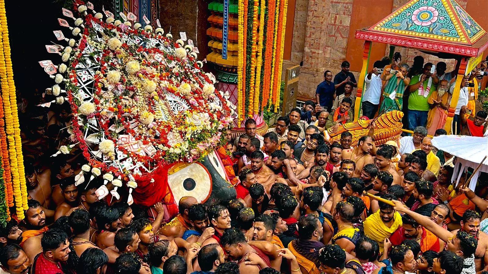
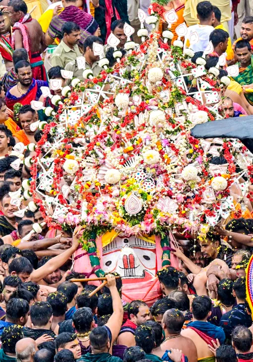
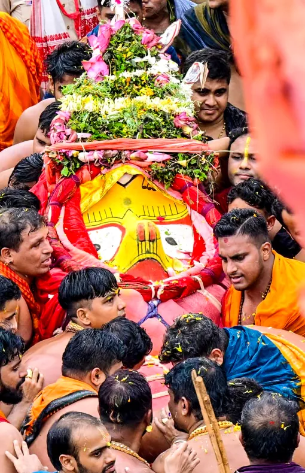
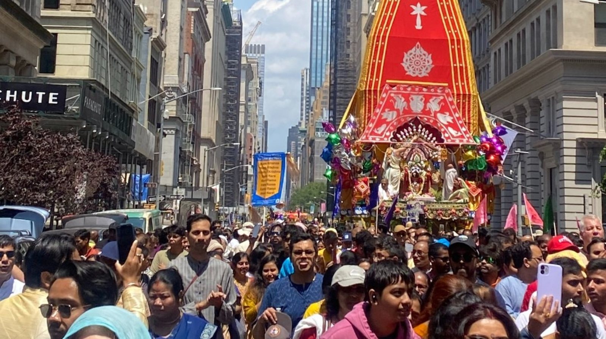

# Rath Yatra: The Sacred Journey of Lord Jagannath

*The three chariots of Lord Krishna, Balabhadrhra, and Devi Subhadra*

## Introduction

Rath Yatra, or the Festival of Chariots, is one of the most iconic Hindu festivals celebrated predominantly in Puri, Odisha. This grand event marks the annual journey of Lord Jagannath, along with his elder brother Balabhadra and sister Subhadra, from the sanctum of the Jagannath Temple to the Gundicha Temple. It is a festival that unites myth, devotion, culture, and social values into a majestic celebration, drawing millions of devotees from across the world.

## Origins and Mythological Significance

The roots of Rath Yatra lie deep in Hindu mythology. Legends narrate that Subhadra once expressed her desire to visit her maternal aunt’s home. Fulfilling her wish, Lord Jagannath and Balabhadra took her to the Gundicha Temple. This story is celebrated annually in the form of Rath Yatra, symbolizing a divine family reunion. The journey also alludes to Lord Krishna’s childhood pastimes in Vrindavan, evoking sentiments of love and longing.

In another interpretation, the journey is seen as the deities leaving their sacred abode to give darshan to devotees who are otherwise unable to enter the temple, particularly those from marginalized communities. This departure from the temple, where the deities are carried out in grand chariots, represents divine outreach and inclusivity.

## **From Snana Yatra to Rath Yatra**

### **Snana Yatra: The Sacred Bathing Ritual**

The prelude to Rath Yatra begins with **Snana Yatra**, observed on the full moon day of the Hindu month of Jyeshtha. This ritual marks the ceremonial bathing of Lord Jagannath, Balabhadra, and Subhadra. The idols are brought out to the *Snana Mandapa* (bathing platform) and are ritually bathed with 108 pitchers of sanctified water fetched from a sacred well inside the temple premises. The water is infused with medicinal herbs, sandalwood, and aromatic substances.

This extensive bathing is symbolic of purification and also of the Lord’s willingness to be visible to the public. However, as per tradition, this act of public exposure causes the deities to fall ill—setting the stage for the next phase of the ritual cycle.

### **Anavasara: The Period of Seclusion and Healing**

Following the Snana Yatra, the deities are believed to suffer from fever, metaphorically referred to as *Anavasara Rogi Avastha*—a time of divine convalescence. During this phase, which lasts for approximately 15 days, the deities are not visible to the public. They retire to a special chamber known as the *Anavasara Pindi*.

During Anavasara, the temple’s traditional servitors, especially the *Daitapatis*, take over the rituals. This is because the deities, in their 'ill' state, are considered closer to their original tribal form, predating their formal enshrinement. The Daitas, believed to be descendants of the tribal devotee Viswabasu, care for the deities in a very intimate manner.

While the main deities are not seen, devotees are offered *darshan* of special cloth paintings known as **Anasara Pattis**, which represent the deities in their healing state. Devotees believe that worshipping these pattis during Anavasara brings similar blessings.

### **Navayauvana Darshan and Netrotsava: The Lord’s Rejuvenation**

*Sri Jagannath Netrotsava Seva*

At the end of the Anavasara period comes **Netrotsava**, also called **Navayauvana Darshan**, which literally means "the festival of seeing the rejuvenated youth." This is the day when the Lord is believed to have recovered fully from his illness and appears in a new, youthful form. The eyes of the idols, which were symbolically closed during illness, are ritually repainted in an elaborate ceremony conducted in secrecy.

The Netrotsava is performed a day before Rath Yatra. It is believed that on this day, Lord Jagannath regains his divine sight, marking the beginning of the visual re-engagement between the deity and the devotee.

This ceremony also marks the culmination of the crafting and painting rituals by the temple artists, as the freshly repainted deities now look resplendent and ready for their annual journey.

### **Transition to Rath Yatra**

*Sri Jagannath being carried to his chariot ***Nandighosha****

*Sri Balabhadra being carried to his chariot ***Taladhwaja****

*Devi Subhadhra being carried towards her chariot ***Darpadalana****

Once the deities are restored, the grand Rath Yatra can commence. The morning after Netrotsava, amidst chanting, conch blowing, and folk performances, the deities are carried in a royal procession to their chariots—a ritual known as **Pahandi Bije**. From this point, the chariot festival begins in full splendor, as the rejuvenated deities set out for their summer retreat to the Gundicha Temple.

## The Ritual Calendar and Structure

Rath Yatra begins on the second day (Dwitiya) of the bright fortnight of the Hindu month of Ashadha, typically falling in June or July. The festival spans nine days and includes several significant rituals and events:

- **Snana Yatra**: Prior to Rath Yatra, the deities are bathed with 108 pots of sacred water in a ritual bathing festival. This is followed by a period of seclusion called Anavasara, during which the deities are believed to recover from fever.
- **Gundicha Marjana**: A day before Rath Yatra, the Gundicha Temple is ritually cleansed and prepared to receive the deities.
- **Pahandi Bije**: On the day of Rath Yatra, the deities are brought out of the sanctum in a ceremonial procession and placed onto their respective chariots.
- **Rath Yatra**: The three chariots are pulled by thousands of devotees from the Jagannath Temple to the Gundicha Temple, a distance of about 3 kilometers.
- **Hera Panchami**: On the fifth day, Goddess Lakshmi visits the Gundicha Temple in search of Lord Jagannath, expressing her displeasure at being left behind.
- **Bahuda Yatra**: After a stay of seven days, the deities begin their return journey to the main temple.
- **Suna Besha**: Upon their return, the deities are adorned with golden ornaments in a lavish display of divine opulence.
- **Niladri Bijaya**: The final ritual, marking the return of the deities to their sanctum within the Jagannath Temple.

## The Chariots: Symbols of Divinity

Each year, new chariots are constructed using sacred wood brought from specific forests. This massive endeavor is carried out by skilled carpenters belonging to hereditary families. Each chariot has a unique name, design, and associated symbolism.

- **Jagannath’s Chariot**: Named *Nandighosha*, it has 16 wheels and is adorned with red and yellow canopies. It is the tallest chariot and carries Lord Jagannath.
- **Balabhadra’s Chariot**: Called *Taladhwaja*, it has 14 wheels with a blue and red canopy.
- **Subhadra’s Chariot**: Known as *Darpadalana*, this chariot has 12 wheels and bears a red and black canopy, symbolic of Shakti.

Each chariot is also equipped with a charioteer, flag, guardian deities, and side idols known as Parsva Devatas. The ropes used to pull the chariots have sacred names, and the entire structure is imbued with ritual significance.

## Cultural and Social Dimensions

Beyond its spiritual essence, Rath Yatra is a cultural extravaganza. Traditional music, dance, fire-spinning performances, and folk chants animate the streets of Puri. Dahukas, the traditional bards, sing provocative yet symbolic verses called Dahuka Boli, which are considered essential to move the chariots.

One of the most touching rituals is the **Chhera Pahanra**, where the King of Puri sweeps the chariots with a golden broom. This act symbolizes humility, reminding devotees that all are equal in the eyes of God. It is a powerful visual that bridges royal prestige and spiritual servitude.

## Hera Panchami: The Divine Drama

Five days into the stay at Gundicha Temple, a unique ritual unfolds—*Hera Panchami*. Goddess Lakshmi, left behind in the main temple, makes a dramatic visit to Gundicha. Enraged at being excluded, she demands Jagannath’s return. The ritual involves symbolic gestures like breaking part of the chariot and retreating via a secret lane. This event adds a layer of divine interpersonal drama, illustrating the human emotions attributed to deities.

## Bahuda Yatra and Final Rites

After completing their stay at Gundicha Temple, the deities commence the **Bahuda Yatra**, their return journey to the Jagannath Temple. On the way, they stop at the *Mausi Maa* (maternal aunt's) Temple, where they are offered *Poda Pitha*, a traditional sweet believed to be their favorite.

Once back, the deities remain on the chariots for the **Suna Besha**, where they are adorned with over 200 kilograms of gold jewelry. This golden attire signifies divine majesty and abundance. The final ritual, *Niladri Bijaya*, marks the deities’ return to their sanctum, completing the full cycle of the festival.

## Symbolism and Philosophy

Rath Yatra is rich in symbolism:

- The chariots represent the body, the ropes symbolize devotion, and pulling the chariots signifies the soul's journey toward divine realization.
- The festival is also a metaphor for the Lord leaving His comfort zone to bless all devotees, breaking down barriers of caste, creed, and status.
- The public visibility of the deities during Rath Yatra reinforces the idea that divinity is accessible to all, not confined to the sanctum.

## The Global Footprint

*Rath Yatra in New York*

Rath Yatra is not confined to Puri alone. Inspired by the festival, chariot processions are held across India and in major cities worldwide, including London, New York, and Sydney, often organized by spiritual organizations like ISKCON. This global celebration reflects the universality of Lord Jagannath’s message of love, unity, and devotion.
