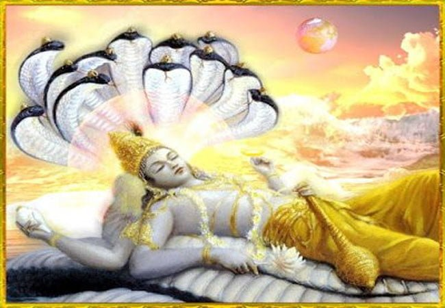
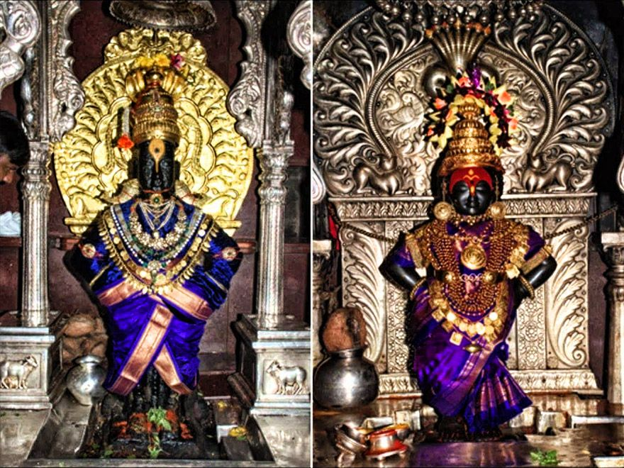
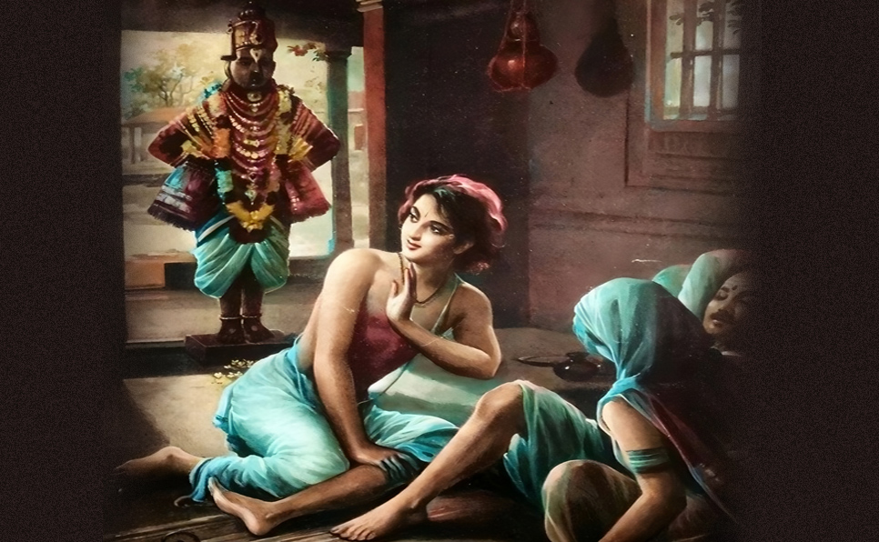

# Āshāḍha Ekādashi, Chāturmāsya, and Pandharpur

## Introduction

Āshāḍha Shukla Ekādashi—observed during the bright fortnight of the month of Āni (Āshāḍha)—is one of the most prominent Ekādashis in the Vaishnava calendar. Known widely as **Devashayanī Ekādashi** or **Prathama Ekādashi**, this day marks the beginning of **Chāturmāsya**, a four-month period dedicated to spiritual discipline, inner reflection, and renewed engagement with dharma.

In western India, this day is also celebrated through the grand **Wārī pilgrimage to Pandharpur**, where thousands of devotees assemble to have darshan of **Pāṇḍuranga Vittala**, a form of Vishnu associated with the devotee **Pundalika**. In this article, we examine these traditions through the lens of Sri Vaishnavism, anchored in the theological insights of Āchāryas such as Śrī Rāmānuja.

## 1. Understanding Ekādashi in Sri Vaishnava Tradition

Ekādashi refers to the 11th tithi of both waxing and waning lunar fortnights. For most Vaishnavas, this day is associated with fasting, increased śravaṇa (hearing), smaraṇa (remembrance), and bhagavad-pūjā.

In Sri Vaishnavism, **most vratas (vows)** are considered **kāmyārtha**—performed for specific material or spiritual outcomes—and are therefore not generally undertaken by those who have performed **sharaṇāgati (prapatti)**, the path of complete surrender. However, **Ekādashi fasting is regarded as an exception**. It is not undertaken for personal gain, but as a **bhagavad-ājñā kāinkaryam**—a devotional act per the Lord’s will.

While not mandatory for prapannas, **observing Ekādashi is seen as a valid expression of discipline and reverence**, especially when aligned with service in temples or as part of one’s family tradition.

## 2. What Makes Āshāḍha Ekādashi Special?

*Lord Vishnu entering yoga-nidrā*

Āshāḍha Ekādashi is unique because it marks the start of **Chāturmāsya**, a four-month period of intensified spiritual practice. It is called:

- **Devashayanī Ekādashi** – the day when Vishnu is believed to enter yoga-nidrā (cosmic sleep)
- **Prathama Ekādashi** – “the first” of the Chāturmāsya Ekādashis
- **Maha Ekādashi** – because it sets the spiritual tone for the entire season ahead

In Sri Vaishnava temples, this day may include special archanā, Divya Prabandham recitations, and thematic alankāram representing Śrīman Nārāyaṇa reclining in the Ocean of Milk (Kshīra Sāgara).

## 3. Chāturmāsya: Meaning and Observance

**Chāturmāsya** literally means “four months.” It begins on Āshāḍha Shukla Ekādashi and ends on Kārttika Shukla Ekādashi (also called **Prabodhini Ekādashi**).

### Theological Framework

According to Sri Vaishnava āchāryas, Chāturmāsya is a period when:

- Śrīman Nārāyaṇa, having accepted offerings during the first half of the year, enters a state of rest (yoga-nidrā)
- Devotees reciprocate by **entering a state of restraint**, inner purification, and enhanced devotion
- The jīva is encouraged to **withdraw from indulgence** and redirect its energies toward **śāstra, kāinkaryam, and prapatti-smaraṇa**

### Observances

While not obligatory, common Chāturmāsya practices include:

- **Dietary niyamas**: Abstaining from certain items (e.g., curd, salt, or fried foods)
- **Alpa-bhojanam**: Eating less than usual to maintain sattva
- **Svādhyāya**: Study of sacred texts such as the Bhagavad Gītā, Divya Prabandham, Śrī Bhāṣya, or Rahasya Traya Sāram
- **Temple or home-based kāinkaryam**: Helping with archanā, cleaning, or offering naivedyam

In the prapanna framework, these acts are **not seen as merit-producing austerities**, but as expressions of loving service and remembrance.

## 4. Pandharpur: An Overview

*Vittala and Rukmini*

**Pandharpur** is located on the banks of the **Chandrabhāga River** in Maharashtra. It is the principal center of **Vittala worship**, where the deity is considered a manifestation of Krishna/Vishnu.

The temple is ancient, with architectural features suggesting Hoysala and Yādava contributions. It is not one of the 108 Divya Deshams but is honored in many Vaishnava traditions as an **abhimāna kshetram**, or place of deep bhagavad-anubhavam.

The mūrti of **Vittala** is distinct: He stands on a brick (vāṭṭi) with arms akimbo, facing the devotee directly. This iconography is explained by the associated **legend of Pundalika**, which remains central to the site’s sanctity.

## 5. The Full Legend of Pundalika

*Pundalika instructing the Lord to wait*

The story of **Pundalika** is foundational to Pandharpur and explains the origin of the standing form of Vittala.

According to traditional accounts, Pundalika was a householder who lived near present-day Pandharpur. Initially disinterested in dharma and inattentive to his parents, he eventually underwent a transformation—some say after encountering pilgrims or sages—that led him to a life of intense filial devotion.

He began serving his elderly parents with complete attention, treating them with reverence and ensuring their comfort at all times. One day, **Lord Vishnu**, pleased with his transformation, came to his home. At that moment, Pundalika was attending to his parents and could not immediately rise to welcome the divine guest.

Instead, he picked up a brick and requested the Lord to stand on it while he completed his service.

The Lord, far from being displeased, **stood patiently** on the brick, moved by Pundalika’s sincerity. He remained there, taking the form we now see as **Vittala**—the Lord who waits for His devotee.

From a Sri Vaishnava lens, this story exemplifies the doctrine that **kāinkaryam performed with śuddha bhāva (pure intention)** is itself an act of divine worship. It affirms the teaching of Rāmānuja that even gr̥hastha-dharma, when aligned with surrender and service, leads to anubhava of Bhagavān.

## 6. The Wārī Pilgrimage: Collective Bhakti in Action

Every year, lakhs of devotees called **Warkaris** undertake the **Wārī**, a walking pilgrimage to Pandharpur, culminating on Āshāḍha Ekādashi.

The tradition dates back several centuries and includes:

- **Pālkhī processions** of saints like Sant Tukaram and Sant Dnyaneshwar
- Singing of **abhangs**—Marathi devotional verses rich in personal bhakti
- A focus on **sāmūhika bhajana (group worship)**, sat-sanga, and community service

While the liturgical practices differ from South Indian Vaishnava modes, the spirit of the Wārī echoes themes central to the Azhvārs:

- Devotion irrespective of caste or social status
- Spontaneous remembrance of the Lord through song
- Communal movement as a form of spiritual ascent

## 7. Observing Āshāḍha Ekādashi Today

For Sri Vaishnavas, Āshāḍha Ekādashi may be observed in a number of ways:

- **Upavāsam**: Fasting partially or completely (if health and capacity permit)
- **Śravaṇa and Pāṭha**: Reciting Divya Prabandham, Vishnu Sahasranāma, or Gītā
- **Alankāra and Archanā**: Offering flowers, naivedyam, or garlands to the deity at home or in a temple
- **Reflection and Sankalpa**: Formally entering into Chāturmāsya with a personal sankalpa of restraint, study, or service

The key is not austerity for its own sake, but using this time to **re-center one's life in alignment with divine purpose**—without attachment to the fruits of the actions.

## Conclusion

Āshāḍha Ekādashi, or Prathama Ekādashi, marks the beginning of a distinct season in the Vaishnava calendar—one of inner restructuring and spiritual discipline. Through the story of **Pundalika**, the practices of **Chāturmāsya**, and the cultural expression of the **Pandharpur Wārī**, this day brings together personal devotion, social expression, and scriptural rhythm.

In Sri Vaishnava thought, these traditions converge to emphasize that **true devotion is not confined to rituals but is equally present in attentive, sincere service**—whether in temples, homes, or on the paths walked by millions.
