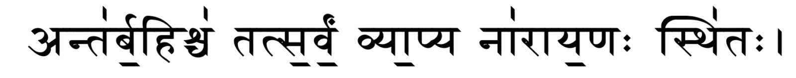
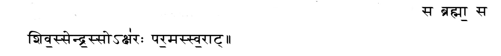

# Bhagavatham-02

**नारायणं नमस्कृत्य नरं चैव नरोत्तमम् ।

देवीं सरस्वतीं व्यासं ततो जयमुदीरयेत् ।।**

As discussed yesterday Parikshith had been cursed by the son of Maharishi Shamika to die of a snake bite in seven days of throwing the snakeskin on his father and so to spend his time in a meaningful manner Parikshith along with hundreds of sages assembled at Shuka Maharishi’s Ashrama to take part in listening to Srimad Bhagavatham.

Shuka Maharishi started his discourse and went about this in a very orderly fashion. He first establishes the different forms of yoga and dharma that one must follow in life. Then he explains the concepts of jeevaathma and paramaathma. In a simplified form, I take verses from the Vedas to describe what Shuka Maharishi has beautifully described Lord Sriman Narayana.

The first verse translates to inside and outside everything in creation is Sriman Narayana himself.

The second verse translates to He is Brahma, He is Shiva, He is Indra, He lies in every atom that has been created, and He is supreme.

After this Shuka Maharishi goes on to describe time and space and how it is oriented.

For this segment I will first give a mapping of space then I will map time. This is extremely complicated and I ask you as a reader here to try to imagine and create an image in your mind as to what I will portray now. To map space let me give an example.

I am writing this in the city of Bangaluru. Where is Bengaluru, in Karnataka? Where is Karnataka, in South India? South India lies in the southern part of the huge nation India. Where is India, it is part of the Indian Subcontinent. Where is this Subcontinent, it is part of Asia. Where is Asia, it is a part of the landmass that constitutes the Earth.

Now we have mapped the earth. Earth, as referred to in our texts, is called Boohu (भूहु). Above this lies a worldly layer called Buvaha(भुव:), then atop this Suvaha (सुव:) then, Mahaha (मह:) then Janaha (जन:), then Tapaha(तप:) then lastly Satyam (सत्यम्). Similarly below Buvaha lie seven worlds known as Athala(अतळ), Vithala (वितळ), Suthala(सुतळ), Rasaatala(रसातळ), Thalaathala (तळातळ), Mahathala(महातळ), and Pathala (पाताळ). Now imagine this as a fourteen layered cake with Boohu in the middle with seven layers above and below it. Now imagine these fourteen layers to be present in an egg. This egg was created by Brahma thus it has got the name Brahmandam(भृह्मान्डम्). Now, this egg has a shell to protect it called, Aavaranam (आवर्णम्). Now above and below Boohu, there is fluid called Aavarana-Jalam (आवर्णजलम्). Now take this egg and assume that it is placed in some corner of space. Now above this egg lie Vayu Lokam(वायु लोकम्), Agni Lokam(अग्नि लोकम्), Surya Lokam(सूर्य लोकम्), Chandra Lokam (चंद्र लोकम्), Nakshathra Lokam (नक्षत्र लोकम्), Minnal Lokam (मिन्नल लोकम्), and lastly the Saptarishi Mandalam (सप्तर्षि मंडलम्). Now, this egg along with the six lokas and the Saptarishi Mandalam is taken to be suspended within the eye of an inverted dolphin (सिंशुमारम्). This dolphin is said to be rotating like a chakra hence it is called a Simshumara-Chakra (सिंशुमारचक्रम्). Along the periphery of this chakra lies the Dhruva-Mandalam(दृवमंडलम्). Now, this dolphin along with the Dhruva-Mandalam is held by the Lord in the Lotus emanating from his navel (नाभिकमलम्). Thus the concept of space comes to a close.

Now let’s try to grasp the concept of time from the creator’s perspective in correlation to how we comprehend time.

We know that one-minute consists of sixty seconds, similarly, an hour has sixty minutes, twenty-four hours constitute a day, an average thirty days constitute a month, twelve months constitute a year. Four lakh thirty-two thousand such years constitute Kali Yugam. Two times this constitute Dwapara Yugam. Three times Kali Yugam constitute Treta Yugam and finally, four times Kali Yugam constitute Krita Yugam. Now take all these four yugas together. It will form one Chaturyugam(चतुरयुगम्). When thousand such chaturyugams pass, it is as though one second has passed for Brahma. When two thousand such chaturyugams pass, it is as though one day passes for Brahma. Like this when three hundred and sixty days pass for Brahma it will constitute a year. The office lifetime of one Brahma is hundred such years. These hundred years are taken in two halves. After these hundred years, the next Brahma succeeds the presiding Brahma. Now a thousand chaturyugams constitute one Kalpa(कल्प). To look over each Kalpa, Brahma assigned fourteen demigods known as Manu. These fourteen Manus rule seventy-one chaturyugams each. We currently fall under the seventh Manu who is Lord Surya who is given the title Vivasvaan(विवस्वान्). Under his tenure, we are currently in the twenty-eighth such chaturyugam out of the seventy-one and in this twenty-eighth chaturyugam, we are currently in the Kali Yugam. Now we will look at how we will map time and space like a coordinate system. It will look something like this:

अद्य भृह्मण‌: द्वितीय परार्ते श्वेतवराहकल्पे वैवस्वतमनवंतरे अष्टाविंशतितमे कलियचगे प्रतमेपादे जम्भूद्वीपे भारतवर्षे भरतखण्डे (करनाठ)देशे कावेरीतीरे मेरो: (दक्षिणे)पार्ष्वे अस्मिन् वर्तमाने (वि‌ळंभि) नामसंवत्सरे (दक्षिण)यने (शरद)ऋतौ (वृश्चिक)मासे (कृष्ण)पक्षे (चतुरयाम्) तिथौ (इन्धु)वासरयुक्तायाम् (पुनर्वसु)नक्षत्रयुक्तायाम् ...

To translate this,

To the Modern Day's Brahma,who is in the second part of his official lifetime, in the Shwethavaraha Kalpa, in the Vaiasvatha Manvanthara, in the twenty-eighth chaturyugam, specific to Kali Yugam, in the first quarter of Kali Yugam, in the JambuDweepam, in the land of Bharatha, in Karnataka, along the banks of the Kaveri River, to the South of the mountain Meru, in the present day, in the year called Vilambi,in the second half of the year, in the Sharad Season, in the Vrushchika Month, during the fourth day of the waning phase of the moon, on Monday, under the star sign of Punarvasu.

()* The quantities that appear in the bracket in the above section are subject to change from time to time and from place to place. I have written this in correlation to Bangaluru.

So we can see how specific our date system was back in the day.
