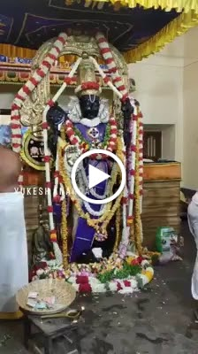

# Rising of Athi Varadar

A very warm welcome to all my readers. Today I'll be giving you an insight into the "Rising of Athi Varadaraja". Athi Varadaraja Swamy is a presiding deity of the Kanchipuram Varadaraja Swamy Temple. As per temple tradition, he rises once every forty years from the temple tank and can be seen by all his devotees. I'll now attempt to take you through a brief history of how this tradition came to be.

**The emergence of Athi Vardar**

As per temple history, the Lord first came to be in the Satya Yuga. The first account of the Lord is mentioned in the Ramayana. As we know the great King Dasharatha performed the Putrakameyishti Yagam to obtain children. The Putrakameyishti is a supplement to the Ashwamedha Yagna. It is said that Dasharatha first performed the Ashwamedha and the origin of the Lord is found here. It is said that Dasharatha asked his son-in-law, sage Rishyashrunga to make arrangements to perform the Ashwamedha where he tells the story of an Ashwamedha Yagna performed by Lord Brahma. The story states that Lord Brahma once performed an Ashwamedha Yagna in a very sacred place that would provide a multifold of merit. In his research, he decided that he would perform this Yagna at a place known as Hasthigiri. It is said that he sat atop Hastigiri and prepared the sacrificial altar. According to Vaideeka Shastram, Goddess Saraswathi had to accompany Lord Brahma in order to perform this Yagna. At this point, he was faced with two problems. The first being Goddess Saraswathi was not present and the second being there was no image of Lord Vishnu that was present at the sacrifice. Lord Brahma decided to address the second problem first. To address this problem, Lord Brahma summoned Vishwakarma, the architect to the Devas and had him design an image of Lord Vishnu. Lord Brahma wanted this idol to be useful for the generations to come and hence looked to make the idol of the Lord with a material whose properties would be beneficial to anyone who seeks the blessings of the Lord. Lord Brahma's four heads signify each of the four Vedas. That is when Lord Brahma recollected that in the Atharvana Veda, there was a mention of a tree known as Udhumbara which is a tree when worshiped with devotion has the power to annihilate any forces of enmity to the worshiper. So what is Udumbara? Udumbara is a tree known as *Ficus racemosa* which belong to the fig family (athi tree). Brahma selected this tree as it has numerous benefits in accordance with the Ayurveda. Hence, Vishwakarma crafted the wood from the fig tree into a resplendent idol of the Lord. So the second problem was solved. To address the first problem, Lord Brahma decided to call upon his second wife Goddess Savitri to take Goddess Saraswathi's place. It is said that Goddess Saraswathi had gotten into a tussle with Lord Brahma and had decided to seek solace to contemplate what had gone wrong. When Goddess Saraswathi got to know of what Lord Brahma was doing, she became furious. In a fury, she decided that she wanted to destroy the sacrificial altar and hence put a stop to the Yagna in totality. It is said that Goddess Saraswathi took the form of a river known as Vegavathy and started to flow with a rapid speed towards the altar. Before Goddess Saraswathi could reach the altar, she witnessed the idol of Athi Vardar and decided to flow beneath his feet as a mark of respect to her father-in-law. Thus the Yagna reached a conclusion. During the culmination of the Yagna, out of sacrificial alter rose a resplendent Vimanam known as Punyakoti Vimanam and in the shade of this Vimanam was a beautiful utsava moorthy of the Lord known as Perarulaalan or Varadarajan.

**Modern Day**

Around the 1520s The Vijayanagara empire were the rulers of South India. They contributed immensely to the temple. One such contribution is the "Noor-Kaal Mandapam" or a Hundred Pillared Mandapam that was built by Achyutha Deva Raya the brother of the great Krishna Deva Raya. Around the 1600s there was a change that was seen in the Delhi Sultanate when the Mughals took control of North India and began expanding down south. Towards the end of the Mughal Rule when Aurangzeb took over, he began to plunder the temples and loot their wealth. The Vaishnavas of Kanchipuram wanted to protect the Moola Vigraham as well as the Utsava Moorthy from the invasion. In order to protect the Utsava Moorthy, the idol was carried by palanquin to a remote place called Udayarpalayam where the local chief agreed to host and protect the Lord. Now to protect the Moola Moorthy was a herculean task as the idol was close to 9 feet in length. Thus a place had to be discovered where the Lord could be kept safe. The Vaishnavas at that point in time dug a huge pit within the temple tank ( Ananthasaras) and embalmed Athi Varada and placed him along with Adisesha in order to protect the Lord.

Over a period of time, the temple did not have a Moola Moorthy or an Utsava Moorthy. After Aurangzeb's invasion, the temple was in ruins with the Punyakoti Vimanam totally destroyed. Thus the temple was reconstructed but the daily rituals of the temple couldn't be performed in the absence of the Lord. Hence after major tussles with the chief of Udayarpalayam the Utsava Moorthy was brought back to the temple. But the Moola Moorthy was lost as the people who had dug the pit were either very old or had passed away. Thus the temple needed to install a Moola Moorthy in the temple. Thus an idol of the Lord known as Devaraja was found in a hamlet known as Pazhayasheevaram was brought to Kanchipuram and installed in the temple. Later sometime in the 18th Century when the temple tank was being cleaned, the idol of Athi Varada was found. At this time, the scholars came to the consensus that idol will be preserved and the idol of the Lord shall grace the devotees for a period of 48 days after which the idol shall be kept back in the temple tank to rise again after a period of 40 years.

As of 28/6/2019, the lord was removed from the temple tank. He will grace his devotees from the 1st of July till the 15th of August before he returns to the depths of the temple tank for another forty years. Those of my readers who are interested may make a trip to Kanchipuram and have a glimpse of the Lord.

**कायेन वाचा मनसेन्द्रियैर्वा
बुद्ध्यात्मना वा प्रकृतेः स्वभावात् ।
करोमि यद्यत्सकलं परस्मै
श्रीममन नरायणायेतिसमर्पयामि ॥**

**सर्वं श्रीकृष्णार्पणम् अस्तु।।**
