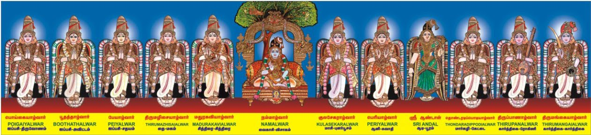

# Azhwar Vaibhavam - An Introduction

A warm welcome to all my readers over the next few days I'll attempt to take you across the rich history of the Tamizh language. (Zh is pronounced as l)

An important and often forgotten part of Tamizh history is the story of the twelve Azhwar saints who spread the message of Bhakti among the masses of South India. The twelve azhwars are often seen as a Hamsam ( reincarnation) of Lord Sriman Narayana. They dedicated their lives towards the service of Empurmaan ( as Lord Vishnu is called dearly in the Tamizh Language). They praised the Lord in the local language which was better understood by the masses rather than to a target group that knew the Sanskrit language.

These Azhwars were born in various parts of our country but they were all united in a common subject, ie dedicating their lives and praising the Lord.

Poigai Alwar, Bhoodath Alwar, and Pei Alwar are collectively called as "Mudhal Alwars" were found in the same period of time.

Thirumazhisai Alwar, who thought the Perumal as his friend and has sung Mangalasasanam on Perumal.

Thirumangai Alwar, who was a great king in his starting of life but later changed his life to working for the Perumal and for his bhaktas.

Thondaradippodi Alwar, who is also named as "Vipra Narayanar" led his life as the slave to the Perumal and worked for the Perumal by dedicating him with Garlands.

Thiruppaan Alwar, who belonged to the Paanar family praised the Perumal through his beautiful songs and Paasurams.

Periyalwar, is considered as the Mother, Father for Sri Andal and Father-in-Law to Perumal has sung Mangalasasanam on Perumal.

Sri Andal, who is also called as "Soodikkodutha Sudar Kodi" is said to be the daughter (brought up) of Periyalwar has created "Thiruppavai" in which she considers Sriman

Narayanan as her husband. She is the only lady alwar.

Nammalwar, who sat below the Tamarind a tree without having any food and sleep got Gnana and has sung Mangalasasanam on Perumal and he has worked hard to spread Sri Vaishnavam.

Madhurakavi Alwar, who is said to be the Sishyan (Student) of Nammalwar is also one among 12 Alwars.

Kulasekara Alwar, had great bhakti towards Sri Ramar has also done Mangalasasanam on the Perumal particularly in Malayala Naatu thriuppathigal.
