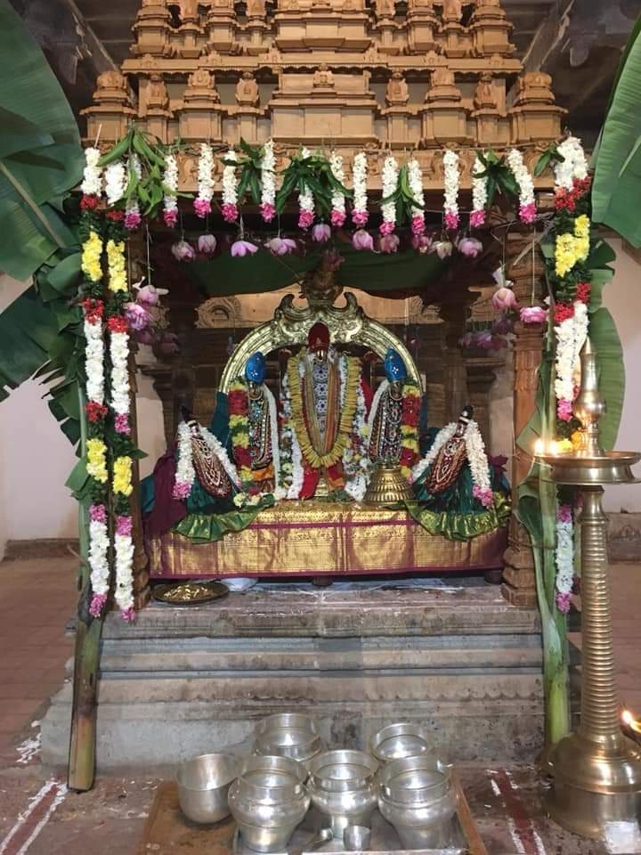

# Kaisika Maahatmiyam

Kaisika Ekadesi is celebrated in the Tamil Month of Kaarthigai on the succeeding Ekadesi in the Sukla Paksham.This is named after the Kaisika Puranam which is 48th Chapter in Sri Varaha Puranam.The message behind the day reinforces the fact that caste is not a hindrance in attaining the lotus feet of Sriman Narayana and true Bhakthi alone is enough. This story happened in the Divyadesam of Thirukurungudi, one among the Nava Tirupathi in Thirunelveli. Nambaduvaan was born in low chandala kulam, but was a devotee of Sriman Narayana. On every Ekadasi he observed Vratham without sleeping full night, singing the glory of Lord and thinking about him. On one karthigai Ekadasi, Nambaduvaan left to Kurungudi nambi temple to observe his fast and render some paasuram using various Paan on Sri Kurungudi Nambi.On his way, Nampaduvan was confronted by a Brahma Rakshas. This Rakshas who has been starved off food, tells Nampaaduvaan that he would devour him. Nampaduvan humbly requests that he has the duty of nama sankeerthanam. Nampaduvan pleads with the rakshas that he would return back after his vratham and darshan of Kurungudi Nambi.He promises that he would indeed return; he mentions of the various sins that he would get, if he were not to return.But for none of Nampaduvan’s promises, BrahmaRakshas was not satisfied. At last Nambaduvaan promised that “Who ever thinks/say that Supreme Lord Sriman Narayanan is equivalent/on par with or inferior with other devathas, that paaapam would catch me!" After hearing this Brahma Rakshas was moved and impressed with such a strong promise and said now I believe on you, you can go now and soon return back. I will wait for you till your return”Nambaduvaan happily went to Sri Kurungudi temple, observed his jAkratha vratham and completing his vratham with the singular determination, he returns as stated back to BrahmaRakshas. Nampaduvan went and offered himself to the Rakshas. But his hunger had vanished and instead he was moved by the truthfulness of the Vishnu devotee.The Brahma Rakshas then told his story – he was a Brahmin who was cursed to become a Brahma Rakshas by his elders as he had not performed yajnas carefully.The Rakshas then asked Nampaduvan to give the reward of one of his prayers so that he can get liberation. Hearing the pleas of the BrahmaRakshas, Nambaduvan said that he never sang for any palam. But still he will request Thirukurungudi Nambhi to releive the BrahmaRakshas of his sins. Nambhi gives the palam of the last paasuram and relieves BrahmaRakshas of its sins. This story strongly reiterates that true Bhakthi is enough to attain Him and caste of a person is totally insignificant.It is believed that those who read or listens to ‘kaisika purana’ on that day, will be showered with Lords abundant mercy! The story of Nampaduvan is narrated and acted in Vishnu Temples in South India on the Kaisika Ekadasi. Sri Parasara Bhattar chanted kaisika puranam before Lord Ranganatha and the same tradition is continuing till date with the descendants of Bhattar chanting the puranam on kaisika dwadasi day at Srirangam each year.Kaisika Ekadasi is considered even more significant to Vaishnavas than Vaikunta Ekadasi, as it implies the stead-fasted Bhakti towards Sriman Narayana and His abundant mercy on His devotees.

Thirukurungudi Sri Vaishnava Nambi Dhivya Sevai in Kaisika Mandapam.
