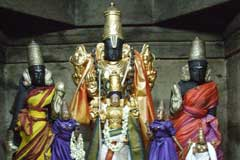

# 108 Divyadesam- 7) Tirukkandiyur

 **Details of Kshethram:**  **Moolavar:** Hara Shapa Vimochana Perumal **Thayaar:** Kamalavalli Thayaar **Vimanam:** Kamalakrithi Vimanam **Pushkarani:** Kapalamoksha Pushkarani

**Travel:** This kshetram is located around 2 km from Tiruvaiyaru.

[googlemaps https://www.google.com/maps/embed?pb=!1m18!1m12!1m3!1d3918.3594777790995!2d79.10674481428758!3d10.860239260611964!2m3!1f0!2f0!3f0!3m2!1i1024!2i768!4f13.1!3m3!1m2!1s0x3baac14ca1435449%3A0x161579ece67d1ac6!2sSri%20Hara%20Saabha%20Vimochana%20Perumaal%20Temple%20(divya%20desham-15)!5e0!3m2!1sen!2sin!4v1586935623786!5m2!1sen!2sin&w=400&h=300]

**Azhwar Pashuram:** 1- Thirumangai Azhwar

**Sthala Puranam:**

As in Tirukarambanur, the fifth head of Lord Brahma which was plucked out by Lord Shiva got stuck to his hand and got unstuck only after Poornavalli Thayaar offered alms to him filling the Brahmakapalam. It is said that the Brahmahatya-Dosha Pariharam was given by the Lord present here. Hence the Lord got the name Hara Shapa Vimochana Perumal.
