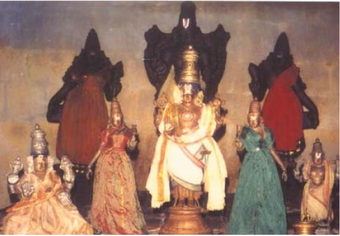

# 108 Divyadesam-35) Tirudevanaar Togai

 **Details of Kshethram:**  **Moolavar:** Devinayakan **Thayaar:** Sridevi Bhoodevi **Pushkarani:** Shobana Pushkarani **Vimanam:** Sobhana Vimanam **Travel:** 6 kilometers from Sirkazhi

[googlemaps https://www.google.com/maps/embed?pb=!1m18!1m12!1m3!1d3913.8756344852536!2d79.77334791428999!3d11.196836354355685!2m3!1f0!2f0!3f0!3m2!1i1024!2i768!4f13.1!3m3!1m2!1s0x3a54e04f3df8246d%3A0xc6825c3dea416f9c!2sDivya%20Desam%2035%20Deiva%20Nayaka%20Perumal%20Temple!5e0!3m2!1sen!2sin!4v1586939644151!5m2!1sen!2sin&w=400&h=300]

**Azhwar Pashuram:**
Tirumangaiazhwar: 10 Pashurams

**Sthala Puranam:**
Legend has it that all the devas along with Vasishta Muni assembled here at this kshethram after Samudra-Mathanam and worshipped the Lord here.
