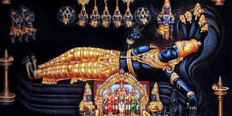

# 108 Divyadesam - 76) Tiruvattaaru

 **Details of Kshethram:**  **Moolavar:** Sri Aadikeshava Perumal **Thayaar:** Margathavalli Nachiyar **Vimanam:** Ashtanga Vimanam **Pushkarani:** Vattar Theertham **Travel:** This kshethram is located at Tiruvattar, Kanyakumari District in Tamil Nadu.

[googlemaps https://www.google.com/maps/embed?pb=!1m18!1m12!1m3!1d3947.728969089598!2d77.26384831403192!3d8.329706794007816!2m3!1f0!2f0!3f0!3m2!1i1024!2i768!4f13.1!3m3!1m2!1s0x3b045437abf739ad%3A0x2a3fe423076b5c03!2sSree%20Athikesava%20Perumal%20Temple!5e0!3m2!1sen!2sin!4v1586973096718!5m2!1sen!2sin&w=400&h=300]

**Azhwar Pashuram:**

Namazhwar : 11 Pashurams

**Sthala Puranam:**

The legend tells the tale of the Lord defeating the demon named Adikeshi. After his death, Adikeshi's wife performs penance and asks Ganga and Tamaraparani rivers to engulf the area by going in a circular pattern. The Lord is said to have taken this form and slept atop the meeting point of the rivers. Seeing that her effort in trying to get revenge was in vain, Adikeshi's wife is said to have surrendered to the Lord. Another story tells us how the Lord took his current form. There was said to be a Maharishi named Hathalekar. He was of very short stature but was extremely learned at a very young age. One day the Lord decided to test Hathalekar Maharishi. The Lord is said to have come and started to tease the sage based on his height. A moment came when the sage was standing next to a banana tree and the Lord asked the sage if his parents were dwarfs that they gave birth to someone of his stature. The sage in a fit of rage said his parents pointed towards the banana tree with faith in the Lord knowing he would save him from the impending trouble. Pointing at the tree the sage said it was his parents. The Lord did not want to disappoint his devotee and emerged out of the tree and told the boy that it was a test of his faith and devotion. The Lord was impressed with the sage and gave him the *ashtakshara-mantram*. He then instructed the sage to reconstruct His Adikeshava Perumal form in a *shila vigraham* form. Hathalekar used to perform *tiruvaradhanam* daily to 16,008 *shalagramams*. It is said that the Lord was brought into this form by using the *shalagramams*, *limestone, mustard,* and *sugar*. Thus there is no *abhishekham* performed at this kshethram. The Lord is preserved by the application of different medicinal herbs and oils as prescribed by *Ayurveda, Shilpi Shastras,* and *Agama Shastras*.
The Lord here is very similar to Sri Ananthapadhmanbha Swamy at Tiruvananthapuram. The Lord here is reclining at a length of **22 feet** versus **18 feet** at Tiruvananthapuram. Another difference is in the *nabhi-kamalam* of Adikeshava Perumal. One cannot find Lord Brahma in the *nabhi-kamalam* as the Lord is said to have appeared before the creation of Lord Brahma. Again there are three doors through which one will see the Lord's *tirumukham, nabhi*, and *tiruvadi*. It is said that Sri Ananthapadhmanabha Swamy is reclined in such a way that He faces Sri Adikeshava Perumal.
