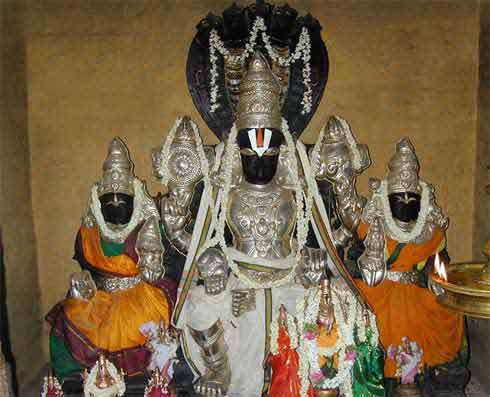

# 108 Divyadesam - 80) Tiruvaikuntam / Srivaikuntam

 **Details of Kshethram:**

**Moolavar:** Vaikunthanathar
 **Thayaar:** Vaikuntavalli Nachiyar
 **Vimanam:** Chandra Vimanam
 **Pushkarani:** Brighu Theertham
 **Travel:** This kshetram is located on the banks of Tamaraparani, around 35 km from Tirunelveli.

[googlemaps https://www.google.com/maps/embed?pb=!1m18!1m12!1m3!1d3944.631297057542!2d77.90817021403461!3d8.631348993797323!2m3!1f0!2f0!3f0!3m2!1i1024!2i768!4f13.1!3m3!1m2!1s0x3b0475463fffe953%3A0x7e1853dd3599f8dd!2sSri%20Vaikundam%20Perumal%20Temple%2C%20Nava%20Tirupathi%201!5e0!3m2!1sen!2sin!4v1586973546044!5m2!1sen!2sin&w=400&h=300]

**Azhwar Pashuram:**
Namazhwar: 2 Pashurams

**Sthala Puranam:**

The legend has it that a local thief by name Kaladushaka used to donate half of the loot that he made to the deity in the temple. While the King caught him, Vaikunthanathar appeared before the king and expressed that He is also a culprit, and thus gained the name Kallapiran. Another sthala puranam mentions that a demon Somakan who took away the texts of knowledge from Lord Brahma. Upon praying, Vaikunthanathar killed Somakan, recovered the texts and presented them to Lord Brahma.
