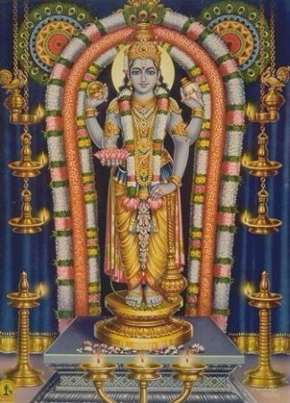

# Guruvayoor

**Details of Kshethram:**

**Moolavar:** Guruvaayurappan

**Pushkarani:** Narayana Saras

**Travel:** This kshethram is located in the town of Guruvayur in Kerala.

[googlemaps https://www.google.com/maps/embed?pb=!1m18!1m12!1m3!1d3921.803076284033!2d76.0371719140544!3d10.594564192445043!2m3!1f0!2f0!3f0!3m2!1i1024!2i768!4f13.1!3m3!1m2!1s0x3ba795301d939041%3A0x875c74d78a16398f!2sGuruvayur%20Temple!5e0!3m2!1sen!2sin!4v1587914170746!5m2!1sen!2sin&w=400&h=300]

**Sthala Puranam:**

According to legend, Lord Guruvayurappan originated even before the start of Krita Yugam. There was once a couple who's names were Prsni and Suthapas who were desirous of having children. To have children, Prsni is said to have undertaken a vratham for twelve days in which she would offer the Lord milk and only have that milk. After consuming the milk, she would sit and meditate upon the Lord by chanting the tirumantram *"Om Namo Bhagavathe Vaasudevaya."*On the thirteenth day, Lord Mahavishnu is said to have appeared in front of Prsni bearing *shankam, chakram, gadha, and padmam.* Seeing the Lord in front of her, Prsni was dumbstruck. The Lord is said to have taken His Panchajanya shankam and placed it on her cheek and then her throat. The first words that came out of her mouth were Sriman Narayana. The Lord then told her that she would be able to speak again and told her to ask Him for children as she wanted. Looking at the Lord's beauty she asked for Him to become her child. She was so awestruck by the Lord's appearance that she asked the Lord to be her child three times. Before she could open her mouth for the fourth time, the Lord closed her mouth. The Lord told Prsni that He was being put in a spot because of her ask. He told her that as she had asked Him to be her child three times, He was debted to be born to her three times as she had performed the vratham with utmost bhakti. Prsni is then said to have asked the Lord not to bless her with children but to stay as He had appeared before her. The Lord told her that it would be impossible for Him to stay physically. He said He would fashion an idol which would have all His features but at the height of 1.5 feet. He told her to think of that idol as the Lord Himself and to keep it safe while performing the daily required pooja to the idol. He then told her that He would take birth three times with Prsni as the mother and Suthapas as the father. He further told her that He would perform pooja to the idol in all the three births. In the first birth, the Lord was born to Prsni and Suthapas as Prsnigarbhan. In the second lifetime, Prsni and Suthapas reincarnated as Aditi and Kashyapa. The Lord was born to them as Vamana. In the third lifetime, Prsni and Suthapas reincarnated as Devaki and Vasudevan. The Lord was born to them as Shri Krishna. After being born to Devaki, the Lord is then said to have reminded them of their previous births and told them that the debt had been relieved. It is said that at the end of Dwapara Yugam before Sri Krishna ascended to Paramapadam, Sri Krishna is said to have handed the idol to Uddava as He wished for it to be preserved for the future. The idol is said to be made of a stone known as *Pathala-Anjanam* which is found only in Sri Vaikuntham. Shri Krishna handed the idol to Uddavan and explained to him that the yugam to come was Kaliyugam which would be filled with adharmam. Shri Krishna was desirous that in a time filled with adharmam, there had to be a force that would answer all the prayers of the devotees and protect them from any danger. Thus He gave the idol to Uddavan and asked him to keep it safe and build a temple for the idol after pralayam. Soon Sri Krishna ascended to Paramapadam and pralayam was at large. As the large wave of pralayam was about to engulf Uddavan, he said to have raised his gaze towards the sky where he is said to have seen Brihaspati (Guru) and Vayu deva. He immediately summoned them and handed the idol along with the responsibility of establishing a temple for the Lord. In the first lifetime, the idol was referred to by the name of Narayanan, in the second He was called Keshavan, in the third lifetime, He was called Madhavan and finally in Kaliyugam the Lord is called Sri Krishnan. Thus in the Tirupavai Andal starts by saying ***" Narayanane namake parai tharuvaan"*** and ends with the pashuram ***" Vangakadal kadaintha Madhavane* *Keshavane."*** Uddavan is said to have told Guru and Vayu to hold on to the Lord till the time where Kaliyugam would come to a phase where mountains would rise, rivers would flow, the ocean waves would rage, houses would be built by man and finally wait till they find such a man who they believed would respectfully worship the Lord. After they found such a man, hand the idol to him and establish a temple for the Lord. Guru and Vayu held the Lord in their hands, performed kainkaryam, and awaited for the time where all of Uddavan's conditions would be met. Guru and Vayu finally came to the sky of Bhoolokam and started to search for a place where they could hand the Lord over to humankind. At one point, they were above the skies of Kerala when they heard a voice calling out to them that asked them to handover the Lord to them. When Guru and Vayu peered down, they noticed Lord Shiva and Devi Parvati who gave land to Guru and Vayu to perform prathishtapanam of the Lord. Even now to date near Guruvayur, there is Shiva-kshethram at Mammiyoor which is at a distance of 1.5 km from Guruvayur. Lord Shiva and Devi Parvati then felt bad as they gave land to the Lord about 1.5 km away from where they are situated. They asked the Lord that they wanted the opportunity to house the Lord in their temple. It is said that the Lord created another idol of Himself in Sri Vaikuntham which was a little taller and placed the idol in their custody. If one visits Mammiyoor today they can see a taller idol of Guruvayurappan next to he sanctum sanctorum of Lord Shiva and Devi Parvati. Thus Guru and Vayu placed the idol of the Lord 1.5 km from Mammiyoor and decided that they would build a temple at that place. It is said that as soon as the Lord heard their decision to construct a temple, the idol of the Lord spoke and told Guru and Vayu that before they construct a temple, He desired a tank(Pushkarani/kolam) to be constructed in such a way that it would be a part of the temple in the center rather than it being away or placed to a corner. It should be constructed in such a way that the devotees can bathe in the tank and immediately enter the temple. As per the Lord's instruction, Guru summoned Varuna Deva and had the tank constructed. As soon as the tank was constructed, the Lord said He was desirous to take a bath in the tank. Guru and Vayu are said to have placed the Lord atop a solid gold plate and bathed Him. The Lord then named the tank as Narayanasaras. After this Devaguru Brihaspati is said to have called all the Devas and performed ***"Ashtabandhana Samprokshana Kumbha Abhishekham"*** to the Lord establishing a temple and completed the prathishtapanam of the Lord. The Lord was impressed with Guru and Vayu and asked them to stand before Him. The Lord then told all the Devas that in a time where humankind would struggle to even think twice about the Lord, Guru and Vayu with immense bhakti had upheld their promise to Uddavan and established a temple for the Lord. Thus the Lord is said to have named the kshethram Guruvayur, in honor of Guru and Vayu. As the Lord stands in Guruvayur, He asked that He be called Guruvayurappan.

As one enters the temple, they should remember the Lord and call Him out by saying Narayana. As they cross the mandapam where Sri Narayana Bhattadri wrote ***Narayaneeyam*** they should remember the Lord and call Him out as Krishna and finally, as they approach the sanctum-sanctorum they should remember and call Him out as Guruvayurappan. So, in conclusion, one must remember and call out to the Lord saying ***" Oh Narayana, Krishna, Guruvayurappa please protect me and be my savior."***
