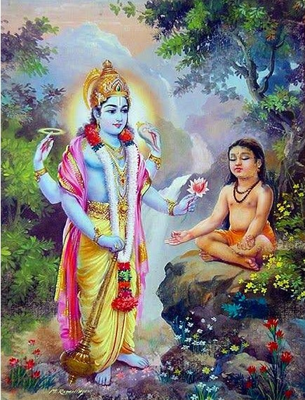

# Vishnu Puranam - 04 - Dhruva Charithram

Today we see Dhruva Charithram.

Dhruva was a prince who came in the lineage of Swayambuva Manu. Dhruva's father's name was Uttanapada. Uttanapada had two wives named Suneeti and Suruchi. Suneeti's son was Dhruva, and Suruchi's son was named Uttama. Suneeti was a very pious lady whereas, Suruchi was only interested in worldly pleasures. One day, when Dhruva was running five years of age, he noticed his step-brother sitting on his father's lap and wished to also sit on his father's lap as well. When Dhruva sat on his father's lap, Suruchi immediately dragged the boy off his father's lap and abused the boy, saying he was not fortunate enough to be born in her womb and threw him away. The child did not comprehend what his step-mother said, but he was sorrowful. He went to his mother and narrated what had happened with his father. As the boy was describing the scene to his mother, the Saptarishis, who had come to console, the boy advised him to seek out Lord Sriman Narayana. Marichi Maharishi told Dhruva to seek Achyutha. Atri Maharishi told Dhruva to find Janardhana, the one who relieves you from the cycle of life and death. Angirasa Maharishi said the boy to seek out Govinda, the one who looks after keeping his words.

Pulastya Maharishi told the boy to seek out Hari, the one who robs you of your sins without causing any trouble, thus; offering moksham. Pulaha Maharishi said the boy to seek out Vishvam, the one who is the cause of everything in creation. Krathu Maharishi told the boy to seek out Yogeshwara, the one who is exemplified by the yoga shastras. Vasishta Maharishi summarized everything said by the other Maharishis saying seek out Maha Vishnu, who is omnipresent, and the cause and effect of everything that happens in this universe. Hearing the advice of the Saptarishis, the boy made his way to the Madura Vanam and started to perform tapas as per Ashtanga Yoga. Ashtanga Yoga prescribes eight requirements for one's tapas to give fruit. The eight instructions are as follows:

1. Yamam

2. Niyamam

3. Aasanam

4. Pranayamam

5. Pratyahaaram

6. Dharana

7. Dhyanam

8. Samadhi

Over time, the boy stopped eating, drinking water, and soon reached a stage of bhakti wherein the boy took a deep breath and stopped breathing. Looking at the intensity of the boy's devotion and tapas, Indra was scared that he would lose his position as the king of the devas. Thus, he immediately rushed to Vaikuntham and performed Sharanagati at the Lord's feet and asked Him to protect his position. The Lord reassured Indra, saying the boy was not after any position but was looking for love and validation. The Lord was impressed by Dhruva's devotion and bhakti and mounted Garuda to visit the boy. Once the Lord appeared in front of Dhruva, he touched the child's cheek with the hand that held the Panchajanyam. As the Lord touched the boy, all the sadness that the boy was feeling till that time instantly disappeared. The vibration of the Pranavam filled the boy's being. The child sat on the Lord's lap and felt elated. The child then asked the Lord why he was going through so much pain so far. Lord Vishnu narrates the story of the boy's previous life, saying the boy was a brahmin in his last life who was friends with a Kshatriya prince. Seeing the prince's riches, he too wished to experience the wealth and the presence of a prince without knowing the responsibilities of a prince. Thus as a prayaschitham for neglecting the recitation of the Vedas and wanting wealth, he was put through abuse in his early years. The Lord then blesses the boy saying he would live a long, fruitful life and would rule as a great king and ultimately achieve moksham.
