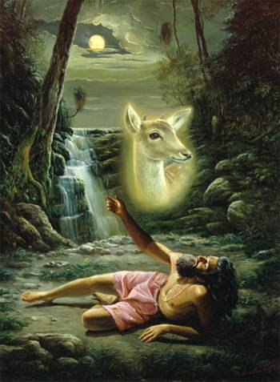
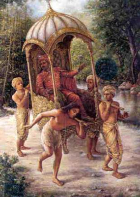

# Vishnu Puranam - 06 - Jadabharata Charithram

Bharatha was a great king who renounced his kingdom and took to yogic worship of Lord Vishnu on the banks of the river Gandaki. One day in his worship, he noticed a female deer that was pregnant, which was jumping from one bank of the river to the other as a tiger was chasing it. As the deer jumped, its sack broke, and the baby deer landed on a floating leaf in the flowing water of the river. Bharatha broke his worship and took the calf from the river to his hermitage. Soon Bharatha dedicated all his time to take care of the baby deer and forgot about offering worship to the Lord. Rapidly the deer grew up and returned to the forest. As time passed, Bharatha attained the age where his aathma was ready to depart from his mortal body. At this time, Bharatha started to think about the deer. It is said that when a person in his dying moments thinks of something material other than the Lord, that person will reincarnate as that which they were thinking about. Hence, Bharatha reincarnated as a deer in his next life. In this life as a deer, Bharatha had a memory of his previous life, and he went back to the place where he used to offer prayers to the Lord. Soon Bharatha again reincarnated into a scholarly family. As he already knew the Lord, he used to act like a dud, which gave him the title of Jada. He became a nomad who used to roam the forests. One day when he was walking the forests, a group of cannibals was capturing meat to sacrifice to Goddess Kali. As he was being sacrificed, the Goddess rejected his sacrifice, stating he had reached the stage of renunciation.

So once again, Jadabharatha was roaming the forest when a royal palanquin of Rahuguna Maharaja came passing by. There was one person short to carry the palanquin, so they dragged Jadabharatha to carry it. As they were carrying the palanquin, they noticed that Jadabharatha wasn’t moving at the same pace as the others carrying the palanquin. The King saw this and told him that you seem well-built, but yet you seem so lazy. To this, Jadabharatha replied, saying he was neither well built nor was he lean, he was neither active nor lazy, he was neither going fast nor slow. The King then thought the palanquin bearers had brought a madman to carry him. So, he asked Jadabharatha to explain his claims. Jadabharatha then told the King that when he was talking about himself, he wasn’t referring to his mortal body but his soul. The soul is neither has a form, nor does it show any activity and is imperishable. For example, if you ask someone to give you some water, they will provide it to you in some sort of bottle or tumbler. You asked him only for water, but he gives it to a vessel. Similarly, the mortal body is but a container for the soul. So Jadabharatha tells Rahuguna Maharaja that the body is but a vessel for the aathma as is the aathma for the Paramaathma.
