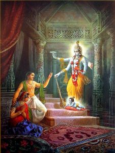

# Vishnu Puranam - 08 - Birth of Sri Krishna

As the atrocities and demonic forces wreaked havoc on the earth, it is said Bhoomi-Devi was not able to handle it. To eliminate the growing inhumanity and to re-establish religious practices on the planet, Bhoomi-Devi is said to have taken the form of a cow and visited Brahma to help her. Brahma then summoned all the celestials, and together all of them went to the heavenly abode of Vaikuntham where Lord Vishnu was resting on his serpent recliner Adisesha. Bhoomi-Devi cried in front of the Lord and pleaded with him to incarnate himself to eliminate all the evil that was causing havoc on the planet. The Lord then is said to throw two locks of hair. One black and the other white signifying that he would reincarnate himself as not one but two forms like Krishna and Balarama. He granted Bhoomi Devi Abaya and ensured her that he would eliminate all the evil and re-establish lost religious practices.

Lord Vishnu decided that he would be born to Devaki and Vasudeva. Devaki was the daughter of the king of Mathura, Ugrasena. On the day of Devaki’s marriage, after all the ceremonies of the wedding were completed, it is customary that the married couple takes a chariot ride together around the city. Kansa, Devaki’s brother, said he would personally drive the chariot. No sooner than the couple had gotten on the chariot did a voice emanate from the sky. It foretold that the eighth child born of Devaki and Vasudeva would be responsible for killing Kansa. As soon as Kansa heard this, he immediately took his sword and took Devaki by the head and threatened to kill her. It was then that Vasudeva promised Kansa that they would hand over any child that was born in exchange for Devaki’s life. Kansa agreed to the condition and detained Devaki and Vasudeva in jail to ensure that they go through with their promise. Soon one by one, all the children were born only to be killed at the hands of their ruthless uncle. The first six children met an untimely end in this manner. The seventh fetus was transferred to Rohini’s womb in Gokul by the Lord’s wish and was declared to be a miscarriage. As Devaki was expecting her eighth child, all the phenomena that she observed seemed contrary to a healthy pregnancy. Usually, when a woman is pregnant, she becomes anemic, which causes her to become pale. But in Devaki’s case, she started to become dark. When Devaki used to walk, she used to feel as though she was cruising and flying as Garuda was said to have been assisting her during this phase. When Devaki was sleeping, she felt the floor to be somewhat slippery and to be in motion as Adisesha was said to have been acting as a bed for Devaki. Shree Krishna was born to Devaki and Vasudev on the eighth day (Ashtami) during the krishna paksha (waxing phase of the moon) in the month of Shraavana. On the day of his birth, it was made to rain very heavily. He also insight deep magic, which put all the guards to sleep. At birth, he showed his parents his divine form and then took the form of a healthy human baby upon the request of Devaki and gave instructions to be carried to Gokul.
