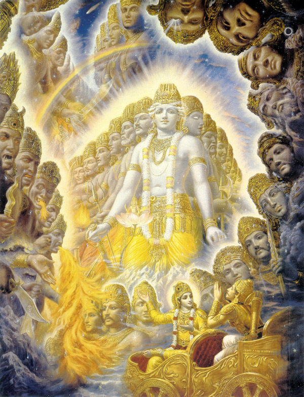

# Nara-Narayana: The Profound Bond Between Krishna and Arjuna

Krishna and Arjuna share a bond that is deep and unique. They embody wisdom and action, respectively, and can achieve extraordinary things. This bond, however, doesn't just apply to cosmic-level events but also translates into daily lives and relationships.

1) **Krishna ensures Draupadi marries Arjuna:** When Draupadi's father held a Swayamvara to choose her husband, it was Krishna who helped Arjuna win the challenge, which involved shooting an arrow through the eye of a fish by looking at its reflection in a pot of water. Krishna had already foreseen Arjuna's victory and ensured that Draupadi's hand in marriage would go to Arjuna, strengthening their bond.

2) **Krishna makes sure Subhadra marries Arjuna:** Krishna plays a crucial role in the union of Arjuna and his sister, Subhadra. Despite Subhadra being sought by other suitors, Krishna orchestrated events such that Arjuna could marry her. This event further illustrates Krishna's intervention in Arjuna's life and his unwavering support for his dear friend.

3) **Krishna becomes Arjuna's charioteer:** Perhaps one of the most poignant and well-known instances of Krishna's deep bond with Arjuna is when he chose to be Arjuna's charioteer in the great battle of Mahabharata. Instead of fighting alone, Krishna guided Arjuna, signifying his deep friendship, guidance, and protection.

4) **Krishna Preaches the Bhagavad Gita to Arjuna:** On the battlefield of Kurukshetra, when Arjuna was confused and morally troubled about fighting against his kin, Krishna delivered the teachings of the Bhagavad Gita. Krishna imparted the wisdom of Dharma, Karma, and the paths of devotion, knowledge, and discipline to Arjuna, showing him the right way forward.

5) **Krishna protects Arjuna from Jayadratha's boons:** Jayadratha, the king of Sindhu, was granted a boon that allowed him to overpower the Pandavas, Arjuna's brothers, for a day. On the day of the battle, Krishna saved Arjuna by creating an illusion of sunset, which tricked Jayadratha and led to his downfall.

6) **Krishna shields Arjuna from Karna's arrows and makes Karna's sarpa-astra miss Arjuna:** In the fierce battle between Arjuna and Karna, Krishna ensures the safety of Arjuna by intervening at crucial moments. When Karna launched the deadly sarpa-astra, Krishna subtly lowered the chariot into the earth, causing the astra to miss Arjuna and strike his crown instead.

7) **Krishna protects Arjuna from the blazing of the chariot after the war:** After the war, when Krishna asked Arjuna to dismount the chariot first, the chariot exploded in a fiery blaze. Krishna revealed that his divine energy had been protecting Arjuna and the chariot from numerous celestial weapons during the war.

In the ancient city of Indraprastha, the story unfolded. A Brahmin approached the mighty warrior Arjuna, trembling with fear and desperation. His tale was one of strange woe: every child born to him and his wife had vanished without a trace immediately after birth. His wife was pregnant again, and he pleaded with Arjuna to save this child from the inexplicable fate that had claimed the others.

Arjuna, driven by the spirit of a Kshatriya, promised to protect the child. He was so confident in his abilities that he vowed to battle Yama, the god of death, if necessary. Further, he declared that should he fail; he would take his own life.

Witnessing these proceedings, Krishna, the embodiment of divine wisdom, offered to assist in this endeavor. Together, they prepared a barricade of arrows around the Brahmin's house, with Arjuna standing guard. The child's birth was imminent, and the woman went into labor inside the barrier.

The cry of a newborn echoed through the night, bringing a moment of relief and hope. However, it was short-lived. The cry was abruptly silenced, and the Brahmin's wails of despair announced the unthinkable: the baby had vanished again.

Arjuna, struck by the gravity of his failure, prepared to make good on his word and end his life. But Krishna intervened, asking Arjuna to join him on his divine chariot.

Their journey was not of this world. Arjuna observed that the chariot was soaring through the dark skies, guided by the luminescent Sudarshan Chakra of Krishna. The vastness and variety of creation humbled Arjuna as they journeyed through various realms populated with countless unique creatures.

Their journey culminated at the Ksheera-Sagara, the milky ocean. Here, Arjuna beheld an awe-inspiring vision: Lord Vishnu, the supreme deity, was reclining on the thousand-headed serpent Adisesha, with Goddess Lakshmi by his side. At the sight of this divine spectacle, Arjuna fell to his knees, tears of reverence and awe streaming down his face.

When he rose, he saw the Brahmin's missing children playing around Lord Vishnu. Krishna revealed to Arjuna the cosmic truth: they were the divine pair Nara and Narayana. Throughout the ages, they restored Dharma, maintaining the balance of righteousness. In their current form, they were Krishna, the divine wisdom, and Arjuna, the human action.

This revelation awakened a more profound understanding within Arjuna. With this knowledge, Krishna and Arjuna returned to earth, bringing the Brahmin's lost children. The story reinforces the profound relationship between Krishna and Arjuna, embodying the fusion of divine wisdom and human endeavor. It demonstrates how they can overcome the most formidable challenges and restore balance and justice when combined.

The relationship between Krishna and Arjuna is based on Nara-Narayana, a concept rooted in Sanathana-Dharma. The Nara-Narayana pair represents the ideal human (Nara) and divine (Narayana) combination. Nara refers to the human soul or spirit, while Narayana represents the divine wisdom. This supreme reality guides the human spirit toward enlightenment.

Krishna (Narayana) and Arjuna (Nara) demonstrate their unique relationship. Arjuna, with his archery skills and warrior spirit, symbolizes human strength, courage, and action. He attempts to save the Brahmin's children through his abilities. Still, when the child disappears, he experiences human despair and is ready to end his life, exhibiting the struggle of Nara.

Krishna, embodying divine wisdom and guidance, steps in at this critical juncture, intervening to prevent Arjuna's suicide. His actions here represent Narayana's role - guiding Nara through struggles and despair. He takes Arjuna on a sacred journey, helping him transcend the normal confines of space and time, exposing him to various worlds, and finally bringing him before the cosmic form of Lord Vishnu, the supreme manifestation of Narayana.

Here, Arjuna witnesses the Brahmin's missing children playing around Vishnu, an experience that reveals to him the deeper workings of the universe beyond human understanding. Krishna then explains their Nara-Narayana relationship, reinforcing the idea that together they restore Dharma across various eras. Krishna underlines the philosophy that wisdom and right action must work together to maintain balance in the world.

Arjuna's realization of this profound truth changes his understanding of their relationship and his role in the grand cosmic design. They return to earth together, bringing back the Brahmin's babies, underscoring their unity in purpose and action.

The Nara-Narayana relationship between Krishna and Arjuna epitomizes the ideal fusion of human endeavor and divine guidance. It shows that when one aligns their actions (Nara) with divine wisdom (Narayana), the results can be transformative for the individual and society at large. The dynamic relationship between Krishna and Arjuna exemplifies this perfect balance, guiding humanity through the path of Dharma.

In the interplay between Krishna and Arjuna, the Nara-Narayana dynamic emerges as a profound philosophical construct extending far beyond ancient texts' narratives. It transcends temporal and spatial boundaries, embodying a timeless, universal truth - that wisdom (Narayana) and action (Nara) are intertwined. One without the other is incomplete, like a body without a soul or a vessel without a rudder.

This symbiotic relationship represents a delicate balance necessary in the cosmos and within our individual lives. It underlines the philosophy that action, no matter how bold, needs the guidance of wisdom to navigate the complex tapestry of life. On the other hand, knowledge without action remains a dormant potential, like an unlit lamp in the darkness.

Thus, the relationship between Krishna and Arjuna serves as a symbolic beacon, illuminating the path of balance, harmony, and righteousness. Their unity in purpose and action, the bond that allows them to restore Dharma, provides a roadmap for navigating our lives, leading us toward enlightenment and self-realization. The Nara-Narayana dynamic is not just a story but a living philosophy. This guiding principle enables us to align our actions within the more significant cosmic order.
